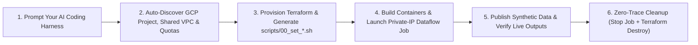

# Dataflow Solution Guides

[](https://github.com/GoogleCloudPlatform/dataflow-solution-guides/actions/workflows/pull_request.yml) [](LICENSE)

The Dataflow Solution Guides provide production-grade **Cloud + Code reference architectures** and full end-to-end deployments for the most common real-time streaming and batch AI workloads on [Google Cloud Dataflow](https://cloud.google.com/dataflow/).

Each guide in this repository includes:

- **Architecture & Solution Documentation** ([`use_cases/`](./use_cases/)): Architectural blueprints, design considerations, one-pagers, and verification runbooks.
- **Cloud Foundation Fabric Terraform Modules** ([`terraform/`](./terraform/)): Lightweight, application-level Infrastructure-as-Code that works in any existing Google Cloud project (with local VPCs or Shared VPCs) and automatically generates the pipeline environment configuration script.
- **Production Apache Beam Pipelines** ([`pipelines/`](./pipelines/)): Reference implementations in **Python 3.14**, **Java 25**, and **Dataflow Flex Templates**, complete with custom containers, synthetic data generators, dead-letter routing, and unit tests.
- **AI Coding Harness Skills & Guidelines** ([`AGENTS.md`](./AGENTS.md) & [`.agents/skills/`](./.agents/skills/)): Built-in instructions and operational skills so an AI coding assistant can autonomously discover your GCP environment, deploy infrastructure, launch and smoke-test pipelines, troubleshoot issues, and cleanly tear everything down.

---

## Solution guides

| Guide | Description | Key GCP Services & Beam Patterns | Stack / Runtime | Assets |
| :--- | :--- | :--- | :---: | :---: |
| [GenAI & Machine Learning Inference](./use_cases/GenAI_ML.md) | Real-time inference with local GenAI models (Gemma 4 with vLLM on GPU) | Pub/Sub, NVIDIA L4 GPU (`g2-standard-4`), Artifact Registry · Beam `RunInference` (`vLLM`), custom GPU container | Python 3.14 (Streaming) | [Terraform](./terraform/ml_ai/) · [Pipeline](./pipelines/ml_ai_python/) · [PDF](./use_cases/guides/genai_ml_dataflow_guide.pdf) |
| [ETL / Integration](./use_cases/ETL_integration.md) | Real-time change data capture (CDC) from a transactional database to an analytical warehouse | Cloud Spanner (Change Streams), Pub/Sub, BigQuery · `SpannerIO` CDC & Google-provided Flex Template | Java 25 & Flex Template (Streaming) | [Terraform](./terraform/etl_integration/) · [Pipeline](./pipelines/etl_integration_java/) · [PDF](./use_cases/guides/etl_dataflow_guide.pdf) |
| [Log Replication & Analytics](./use_cases/Log_replication.md) | Real-time log replication and forwarding from Google Cloud into Splunk | Cloud Logging Router, Pub/Sub, Secret Manager, Splunk HEC (optional IAP demo VM) · Dead-letter routing | Dataflow Flex Template (Streaming) | [Terraform](./terraform/log_replication_splunk/) · [Pipeline](./pipelines/log_replication_splunk/) · [PDF](./use_cases/guides/log_replication_dataflow_guide.pdf) |
| [Marketing Intelligence](./use_cases/Marketing_Intelligence.md) | Real-time customer propensity scoring and next-best-offer personalization | Pub/Sub, Cloud Firestore (Native), BigQuery · Firestore `Enrichment` (TTL cache), Scikit-Learn `RunInference`, Storage Write API & DLQ | Python 3.14 (Streaming) | [Terraform](./terraform/marketing_intelligence/) · [Pipeline](./pipelines/marketing_intelligence/) · [PDF](./use_cases/guides/market_intel_dataflow_guide.pdf) |
| [Clickstream Analytics](./use_cases/Clickstream_Analytics.md) | Real-time clickstream data hydration and user session aggregation | Pub/Sub, Cloud Bigtable, BigQuery · Bigtable lookup enrichment, `Sessions` windowing, Storage Write API `UPSERT`s & DLQ | Java 25 (Streaming) | [Terraform](./terraform/clickstream_analytics/) · [Pipeline](./pipelines/clickstream_analytics_java/) · [PDF](./use_cases/guides/clickstream_analytics_dataflow_guide.pdf) |
| [IoT Analytics](./use_cases/IoT_Analytics.md) | Real-time vehicle/sensor telemetry processing and predictive maintenance alerting | Pub/Sub, Cloud Bigtable, BigQuery · Stateful `DoFn` timers & windowed aggregation, Bigtable enrichment, Scikit-Learn `RunInference` | Python 3.14 (Streaming) | [Terraform](./terraform/iot_analytics/) · [Pipeline](./pipelines/iot_analytics/) · [PDF](./use_cases/guides/iot_analytics_dataflow_guide.pdf) |
| [Anomaly Detection](./use_cases/Anomaly_Detection.md) | End-to-end fraud/anomaly detection with custom training, online serving, and stream scoring | Pub/Sub, Cloud Bigtable, Vertex AI (Custom Training & Prediction Endpoint), BigQuery · Bigtable enrichment, keyed remote `RunInference` & DLQ | Python 3.14 (Streaming) | [Terraform](./terraform/anomaly_detection/) · [Pipeline](./pipelines/anomaly_detection/) · [PDF](./use_cases/guides/anomaly_detection_dataflow_guide.pdf) |
| [Customer Data Platform](./use_cases/CDP.md) | Multi-stream customer event unification and Customer 360 session profiling | Multi-topic Pub/Sub, BigQuery · Dynamic `Sessions` windowing with accumulating triggers, Storage Write API & DLQ | Python 3.14 (Streaming) | [Terraform](./terraform/cdp/) · [Pipeline](./pipelines/cdp/) · [PDF](./use_cases/guides/cdp_dataflow_guide.pdf) |
| [Gaming Analytics](./use_cases/Gaming_Analytics.md) | Real-time gameplay event scoring and low-latency in-game offer activation | Pub/Sub, Cloud Bigtable feature store, BigQuery · Cross-language Python `RunInference` (`SklearnModelHandlerNumpy`) on Portable Runner & DLQ | Java 25 + Python (Streaming) | [Terraform](./terraform/gaming_analytics/) · [Pipeline](./pipelines/gaming_analytics_java/) · [PDF](./use_cases/guides/gaming_analytics_dataflow_guide.pdf) |
| [Synthetic Data Generation](./use_cases/Synthetic_Data_Generation.md) | Relational synthetic BigQuery table generation from a DDL and reference sample | BigQuery (snapshots, landing, DLQ & `validation_runs`), Cloud Storage, NVIDIA L4/T4 GPU · In-worker `vLLM` inference, FK topological ordering | Python 3.14 Flex Template (Batch) | [Terraform](./terraform/synthetic-llm-dataflow-bigquery/) · [Pipeline](./pipelines/synthetic-llm-dataflow-bigquery/) |

---

## Using with an AI Coding Harness (Recommended)

This repository is designed to be used directly inside an **AI coding harness** (such as Antigravity, Gemini CLI, Claude Code, Cursor, Codex, or GitHub Copilot). When you open the repository in your agentic IDE or CLI, the agent reads [`AGENTS.md`](./AGENTS.md) and the specialized skills in [`.agents/skills/`](./.agents/skills/) to orchestrate end-to-end deployments on top of the manual scripts in each folder.



### What the Agentic Harness Automates

- **Pre-Flight Environment & Network Discovery**: Automatically inspects your target Google Cloud project to detect local VPCs or **Shared VPC** host projects (`gcloud compute shared-vpc get-host-project`) and usable regional subnets, verifies Private Google Access (`privateIpGoogleAccess: true`), Cloud NAT, and `dataflow` firewall rules (TCP `12345–12346`), checks for existing GCS buckets and Service Account naming collisions, and checks regional CPU/GPU quotas (`NVIDIA_L4_GPUS` / `NVIDIA_T4_GPUS`).
- **Enterprise Security Guardrails**: Enforces private worker IPs (`--no_use_public_ip`, `--usePublicIps=false`, or `--disable-public-ips`) and dedicated least-privilege Service Accounts across every deployment.
- **Terraform-to-Pipeline Bridge**: Configures `terraform.tfvars`, runs `terraform apply`, and sources the auto-generated environment script (`scripts/00_set_environment.sh` or `01_set_variables.sh`) directly inside the corresponding `pipelines/<use_case>/` directory.
- **Live Smoke Testing & Verification**: Builds custom worker/training/serving containers with Cloud Build, launches the Dataflow job, runs the included synthetic data generators, and queries BigQuery, Cloud Spanner, Cloud Bigtable, Pub/Sub, or Splunk to verify end-to-end data flow and dead-letter queues.
- **Zero-Trace Cleanup**: Cancels or drains active Dataflow jobs first, cleans up non-Terraform runtime artifacts (such as Vertex AI endpoints and models tracked via deployment manifests), and runs `terraform destroy` (`destroy_all_resources = true`) while leaving pre-existing networks, Shared VPCs, and reused buckets untouched.

### Prompt Cookbook (Examples)

Once authenticated with `gcloud auth login` and `gcloud auth application-default login`, you can prompt your coding harness with natural-language instructions like these:

1. **Standard End-to-End Deployment & Live Verification**
   > *"Deploy the Marketing Intelligence guide in project `my-gcp-project` and region `us-central1`. Seed the Firestore customer profiles, launch the Dataflow pipeline, publish a batch of synthetic click events, and verify that scored predictions land in BigQuery with zero dead-letter errors."*

2. **Deploying in an Enterprise Project with a Shared VPC**
   > *"Deploy the ETL & Integration guide in project `my-gcp-project`, region `europe-southwest1`. There is no local network in this project—it uses a Shared VPC. Discover the Shared VPC subnet, deploy the Spanner and BigQuery infrastructure, run the CDC pipelines, and verify rows in BigQuery."*

3. **Inferring Settings from Past Dataflow Jobs & Checking GPU Quotas**
   > *"Deploy and test the Synthetic Data Generation (or GenAI & ML) guide in project `my-gcp-project`, region `europe-southwest1`. There is a Shared VPC from a host project—check past Dataflow jobs in the project if needed to infer the right subnetwork and service account parameters, verify GPU quota availability, run the pipeline, and validate the output tables."*

4. **Troubleshooting Worker Startup, IAM, or Dead-Letter Issues**
   > *"My Dataflow workers in the Clickstream Analytics job are failing to start up (or messages are landing in the dead-letter table). Use the troubleshooting skill to inspect the job logs, network configuration, and IAM bindings, and fix the issue."*

5. **Safe, Zero-Trace Teardown**
   > *"Clean up the Anomaly Detection deployment in `my-gcp-project`: cancel the streaming Dataflow job, undeploy the Vertex AI endpoint and runtime artifacts, and destroy the Terraform infrastructure so the project is left exactly as it was."*

---

## Manual Deployment Workflow (Step-by-Step)

Every solution guide also documents its complete manual CLI runbook in `terraform/<use_case>/README.md`, `pipelines/<use_case>/README.md`, and `use_cases/<Guide>.md`. These deterministic scripts and steps serve both human engineers who prefer running commands directly and AI agents that execute them under the hood:

1. **Provision Infrastructure**:
   Navigate to `terraform/<use_case>/`, configure `terraform.tfvars` (`project_id`, `region`, and optional `subnetwork` or `bucket_name`), and run:
   ```bash
   terraform init
   terraform plan -out=tfplan
   terraform apply tfplan
   ```
2. **Load Generated Environment Variables**:
   Applying Terraform automatically generates an environment script inside the matching pipeline folder. Navigate to `pipelines/<use_case>/` and source it:
   ```bash
   source scripts/00_set_environment.sh   # (or scripts/00_set_variables.sh / 01_set_variables.sh)
   ```
3. **Build Custom Containers (if applicable)**:
   For pipelines that use custom Python 3.14 worker, training, or GPU containers:
   ```bash
   ./scripts/01_build_and_push_container.sh
   ```
4. **Launch the Dataflow Pipeline**:
   Submit the streaming or batch job (configured with private worker IPs and the dedicated service account):
   ```bash
   ./scripts/02_run_dataflow.sh           # (or ./scripts/01_launch_pipeline.sh / 03_launch_pipeline.sh)
   ```
5. **Seed Reference Data & Publish Synthetic Events**:
   Run the included seeder and event publisher scripts (e.g., `scripts/03_publish_events.py`) to simulate real-time traffic.
6. **Verify Outputs**:
   Inspect the Dataflow job graph and query the target sinks (BigQuery tables, Cloud Spanner, Cloud Bigtable, Pub/Sub subscriptions, or Splunk).
7. **Clean Up Resources**:
   Cancel active Dataflow jobs (`gcloud dataflow jobs cancel`), remove any non-Terraform runtime endpoints/artifacts, and run `terraform destroy` in `terraform/<use_case>/`.

---

## Repository structure

- [`use_cases/`](./use_cases/): Solution architecture documentation, PDFs, one-pagers, and end-to-end walkthroughs for each use case.
- [`terraform/`](./terraform/): Cloud Foundation Fabric Terraform modules for provisioning Google Cloud application resources and generating pipeline environment scripts.
- [`pipelines/`](./pipelines/): Apache Beam pipeline implementations in Python 3.14, Java 25, and Dataflow Flex Templates.
- [`AGENTS.md`](./AGENTS.md) & [`.agents/skills/`](./.agents/skills/): Agent guidelines, security guardrails, and operational skills for AI coding harnesses:

| Skill | Location | Purpose |
| :--- | :--- | :--- |
| **`use-case-deployment`** | [`.agents/skills/use-case-deployment`](./.agents/skills/use-case-deployment/SKILL.md) | End-to-end orchestration, environment discovery, synthetic data ingestion, live verification, and ordered teardown across all 10 guides. |
| **`terraform-deploy`** | [`.agents/skills/terraform-deploy`](./.agents/skills/terraform-deploy/SKILL.md) | Pre-flight checks (Shared VPCs, SA collisions, buckets), `terraform fmt`/`validate`/`plan`/`apply`, and safe infrastructure teardown. |
| **`dataflow-pipeline-dev`** | [`.agents/skills/dataflow-pipeline-dev`](./.agents/skills/dataflow-pipeline-dev/SKILL.md) | Developing, formatting (`yapf`, `spotless`), linting (`pylint`), packaging, and locally testing (`DirectRunner`, `pytest`, Gradle) Beam pipelines. |
| **`dataflow-troubleshooting`** | [`.agents/skills/dataflow-troubleshooting`](./.agents/skills/dataflow-troubleshooting/SKILL.md) | Diagnosing Dataflow worker startup failures, IAM permission errors, Private Google Access/NAT/firewall issues, GPU quotas, and container parity. |
| **`pr-review`** | [`.agents/skills/pr-review`](./.agents/skills/pr-review/SKILL.md) | Reviewing Pull Requests, monitoring CI checks, and verifying compliance with security guardrails and coding standards. |

## Getting help

- GitHub Issues: Report any issues or ask questions on the GitHub repository.
  - <https://github.com/GoogleCloudPlatform/dataflow-solution-guides/issues>
- Stack Overflow: Search for existing solutions or ask questions on Stack
  Overflow using the `google-cloud-dataflow` tag:
  - <https://stackoverflow.com/questions/tagged/google-cloud-dataflow>

## Contributing

Your contributions to this repository are welcome.

- Fork and Pull Request: Fork the repository and submit a pull request with your
  changes.
- Follow the Contribution Guidelines: Please follow the contribution guidelines
  outlined in the
  [CONTRIBUTING.md](CONTRIBUTING.md) file.

## Disclaimer

This is not an officially supported Google product. The code in this repository
is for demonstrative purposes only.
