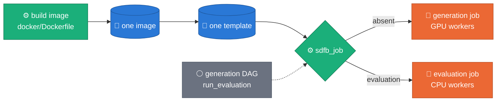

# Deployment prerequisites — GCS & BigQuery

What must exist **before** a pipeline run, and what to provision per environment.

The pipeline is **bring-your-own-infra**: every table and bucket is passed in by URI/FQN, and all BigQuery sinks are `CREATE_NEVER` (`sdfb_beam/cli/run_pipeline.py`). Nothing is auto-created at run time — a missing table or bucket fails the job.

Companion docs (don't restate — link):
- **Model weights** — GCS layout, download, file checklist → [`MODEL_LAYOUT.md`](MODEL_LAYOUT.md)
- **Build / deploy / run** — worker image registry → [ADR 0015](https://github.com/albertols/synthetic-llm-dataflow-bigquery/blob/edcfdcd6a621ecf977e9af7b320996f3a9ea7d48/docs/adr/0015-worker-image-via-artifact-registry.md); a runnable image + Flex Template build on your own project → [`public_cloud/deploy/gcp/README.md`](https://github.com/albertols/synthetic-llm-dataflow-bigquery/blob/edcfdcd6a621ecf977e9af7b320996f3a9ea7d48/public_cloud/deploy/gcp/README.md)
- **Dev env setup** → [`M4_SETUP.md`](https://github.com/albertols/synthetic-llm-dataflow-bigquery/blob/edcfdcd6a621ecf977e9af7b320996f3a9ea7d48/docs/M4_SETUP.md)
- **Run playbook** — GPU verdict, run matrix, Dataflow options, L4 capacity strategy, report recipe → [`RUN_PLAYBOOK.md`](https://github.com/albertols/synthetic-llm-dataflow-bigquery/blob/edcfdcd6a621ecf977e9af7b320996f3a9ea7d48/docs/RUN_PLAYBOOK.md)

Two layers below: **① the portable core** (needed anywhere) and **② optional hardening** (what a locked-down or regulated project typically adds on top).

---

## ① Portable core

### GCS — buckets & objects

| What | Path | Read by | Notes |
|---|---|---|---|
| **LLM weights** | `gs://{bucket}/synthetic/models/{family}/{model}/{version}/` | worker `setup()` warm-pull (`sdfb_beam/gcs.py`) | Self-contained HF-layout dir. Immutable `vN/`. File checklist → [`MODEL_LAYOUT.md`](MODEL_LAYOUT.md). |
| **Embedder weights** (B.1 RAG) | `gs://{bucket}/synthetic/models/embedders/{model}/{version}/` | B.1 DoFn `setup()` | Optional — empty `--embedder_uri` → dependency-free `HashingEmbedder`. |
| **DDL JSON** | `gs://…/…_ddl.json` (`--ddl_uri`) | driver `load_ddl()` | Produced by `scripts/extract_ddl.py`; stage to GCS for the launcher. |
| **Dataflow staging/temp** | `gs://…-dataflow-staging/{staging,temp}/` | Dataflow service | Can be one bucket with prefixes. |
| **Flex Template spec** | `gs://…-dataflow-templates/synthetic/sdfb-<ver>-template.json` | Flex launch | Built by CI ([ADR 0008](https://github.com/albertols/synthetic-llm-dataflow-bigquery/blob/edcfdcd6a621ecf977e9af7b320996f3a9ea7d48/docs/adr/0008-ci-driven-builds.md), [ADR 0009](https://github.com/albertols/synthetic-llm-dataflow-bigquery/blob/edcfdcd6a621ecf977e9af7b320996f3a9ea7d48/docs/adr/0009-single-flex-template-image.md)) or by Cloud Build ([`public_cloud/deploy/gcp/`](https://github.com/albertols/synthetic-llm-dataflow-bigquery/blob/edcfdcd6a621ecf977e9af7b320996f3a9ea7d48/public_cloud/deploy/gcp/README.md)). |

Minimum footprint: a **models** bucket + a **staging/temp** bucket (+ a **templates** bucket, or a prefix on staging for OSS).

### BigQuery — datasets & tables

All sinks are `FILE_LOADS` + `WRITE_APPEND` + `CREATE_NEVER`, so the three destination tables **must be pre-created with exact schemas** — Beam does **not** auto-create them; a missing table fails the load job rather than being created (deliberate: keeps schema authorship out of the pipeline and fails fast on a typo'd FQN).

| Table | FQN pattern | Schema source | Provision |
|---|---|---|---|
| **Reference / source** | `project.dataset.table` (`--reference_table`) | *pre-existing* | The table you clone. Read `SELECT * … LIMIT N` (`sdfb_beam/io/bq_sources.py`). Read access only. |
| **Landing** | `project.synthetic_data.<source table>` (defaults to the DDL table name; override with `landing_table`) | **derived from the target DDL** | `sdfb_core/codegen/derive_bq_ddl.py` turns the `_ddl.json` into a BQ `TableSchema` → `bq mk`. **No committed schema file** — it's per-target (the preflight writes `config/bq_schema/synthetic_data/<table>.schema.json`). |
| **DLQ** | `project.synthetic_data_quality.dlq` | `config/bq_schema/synthetic_data_quality/dlq.schema.json` | DAY-partition on `dlq_inserted_at`. |
| **validation_runs** | `project.synthetic_data_quality.validation_runs` | `config/bq_schema/synthetic_data_quality/validation_runs.schema.json` | DAY-partition on `created_at`. Optional (empty FQN skips the write) but recommended. **ADR 0038 added five NULLABLE columns** (`excluded_blocker_rules`, `source_repeat_share`, `landing_repeat_share`, `repeat_share_delta`, `repeat_share_within_tolerance`) — an existing table must be widened before the next run or FILE_LOADS rejects the summary row (see below). Fix J dropped a sixth, `repeat_share_note`: both shares now describe the declared PK, so there is no "not comparable" case to explain. A table already widened for it keeps a harmless unused column. |
| **rag_chunks** (WS2) | `project.synthetic_rag.rag_chunks` | `config/bq_schema/synthetic_rag/rag_chunks.schema.json` | DAY-partition on `created_at`. **One shared store for the whole project**: chunks from *every* source `dataset.table` coexist, scoped by `source_fqn` and pinned to a vector space by (`embedder_id`, `embedder_version`) — adding a new source table needs **no** new RAG table. Optional (only needed for `--build_rag_layer` / b1 chunk reuse). |
| **fk_fanout_stats** (ADR 0036) | `project.synthetic_data_quality.fk_fanout_stats` | `config/bq_schema/synthetic_data_quality/fk_fanout_stats.schema.json` | **OPTIONAL** — no partition. Absent, unreadable or unwritable: the launcher logs `fk_fanout_cache_unavailable` (WARNING) and measures the fan-out every launch instead of caching it. **No column change for ADR 0038 fix J**: the declared PK's source measurement rides inside the existing `payload` JSON (`pk_source`), under the same `(source_table, edge_cols, model_sha)` key. A row written before fix J simply lacks it, and that launch re-scans the PK alone and rewrites the row. |

Datasets to create: **`synthetic_data`** (landing), **`synthetic_data_quality`** (dlq + validation_runs), and — for the WS2 RAG layer — **`synthetic_rag`** (rag_chunks), in the reference data's region (`europe-west3` here). Schema files are laid out by dataset under `config/bq_schema/<dataset>/<table>.schema.json`. The committed-schema tables map 1:1 to JSON files:

```bash
bq mk --schema config/bq_schema/synthetic_data_quality/dlq.schema.json \
      --time_partitioning_field dlq_inserted_at \
      project:synthetic_data_quality.dlq
bq mk --schema config/bq_schema/synthetic_data_quality/validation_runs.schema.json \
      --time_partitioning_field created_at \
      project:synthetic_data_quality.validation_runs
bq mk --schema config/bq_schema/synthetic_rag/rag_chunks.schema.json \
      --time_partitioning_field created_at \
      project:synthetic_rag.rag_chunks
# optional — skip it and the launcher measures the fan-out every launch
bq mk --schema config/bq_schema/synthetic_data_quality/fk_fanout_stats.schema.json \
      project:synthetic_data_quality.fk_fanout_stats
```

An **existing** `validation_runs` predating ADR 0038 needs its six new
NULLABLE columns before the next launch — adding columns is a
non-breaking schema relaxation, so the committed file is applied
directly:

```bash
bq update --schema config/bq_schema/synthetic_data_quality/validation_runs.schema.json \
      project:synthetic_data_quality.validation_runs
```

After the **first** `--build_rag_layer` population run (BigQuery requires ≥5 000 rows before an index can be created), add the vector index — retrieval falls back to brute-force COSINE until then:

```sql
CREATE VECTOR INDEX rag_chunks_embedding_idx
ON `project.synthetic_rag.rag_chunks`(embedding)
OPTIONS(index_type = 'IVF', distance_type = 'COSINE');
```

Planned retrieval-side optimizations (reranking, metadata filtering) build on this same contract — `source_fqn` scoping, the embedder pin, and the vector index — so treat the `rag_chunks` schema as an API: additive changes only.

#### Provisioning the landing table (step by step)

The **landing** table has no committed schema — it mirrors the target you're cloning, so you derive it from that table's `_ddl.json`. The goal is a reusable **`landing_ddl.json`** (a BQ JSON schema array) that feeds either `bq mk` or Terraform.

**1. Extract the target DDL** (skip if you already have it from step 4 of the bootstrap):

```bash
uv run python scripts/extract_ddl.py \
    --project "$(gcloud config get-value project)" \
    --dataset <source_dataset> --table <source_table> \
    --runner DirectRunner
# → ./output/<source_dataset>/ddl_metadata_<source_dataset>_<source_table>.json
```

**2. Derive `landing_ddl.json`** with `scripts/derive_landing_schema.py`. It unwraps `derive_bq_schema()`'s `{"fields": [...]}` to the **bare array** that `bq` and Terraform want, and prints partitioning/clustering (which live in the DDL, not the schema JSON). Pass `--print-bq` to also emit a ready-to-run `bq mk`:

```bash
DDL_JSON=./output/<source_dataset>/ddl_metadata_<source_dataset>_<source_table>.json

uv run python scripts/derive_landing_schema.py "$DDL_JSON" \
    -o landing_ddl.json \
    --print-bq project:synthetic_data.<source_table>   # landing mirrors the source table name
```

For the `customers` fixture this prints `partitioning: DAY signup_at`, `clustering: country,tier`, a matching `bq mk` command, and writes a `landing_ddl.json` like:

```json
[
  {"name": "customer_id", "type": "INT64", "mode": "REQUIRED", "description": "Surrogate customer key."},
  {"name": "email", "type": "STRING", "mode": "REQUIRED", "description": "Customer email; unique.", "maxLength": 255},
  {"name": "signup_at", "type": "TIMESTAMP", "mode": "REQUIRED", "description": "Account creation timestamp (UTC)."},
  {"name": "country", "type": "STRING", "mode": "NULLABLE", "description": "ISO-3166-1 alpha-2.", "maxLength": 2},
  {"name": "tier", "type": "STRING", "mode": "REQUIRED", "description": "Subscription tier.", "maxLength": 16},
  {"name": "lifetime_value", "type": "NUMERIC", "mode": "NULLABLE", "precision": 18, "scale": 2}
]
```

**3a. Create with `bq mk`** — either run the command `--print-bq` emitted in step 2, or by hand (omit the partition/cluster flags if the DDL had none):

```bash
bq mk --table \
    --schema landing_ddl.json \
    --time_partitioning_type DAY --time_partitioning_field signup_at \
    --clustering_fields country,tier \
    project:synthetic_data.customers   # landing table = source table name (customers)
```

**3b. Or with Terraform** — `landing_ddl.json` drops straight into the `schema` argument:

```hcl
resource "google_bigquery_table" "landing" {
  project    = var.project
  dataset_id = "synthetic_data"
  table_id   = "customers"   # landing table = source table name
  schema     = file("${path.module}/landing_ddl.json")

  time_partitioning {           # from step 2's partitioning printout
    type  = "DAY"
    field = "signup_at"
  }
  clustering = ["country", "tier"]   # from step 2's clustering printout
}
```

The same `landing_ddl.json` also documents exactly what the pipeline will write — it's derived from the identical `_ddl.json` the engines and validators use.

### Config artifacts (required at run time)

- `config/thresholds.yml` — `--thresholds_uri` (gs:// or local); missing → permissive gate.
- `config/models.yml` — registry/reference only; the run takes a full `--model_uri`, not a key.
- `config/relationships/*.yaml` — the versioned PK/FK/identity model ([ADR 0032](https://github.com/albertols/synthetic-llm-dataflow-bigquery/blob/edcfdcd6a621ecf977e9af7b320996f3a9ea7d48/docs/adr/0032-relationships-as-config.md), [`config/relationships/README.md`](../config/relationships/README.md)); required for any relational run (`--relationships-uri` gs:// override supported); absent → every table generates alone. Preflight step 12 validates it.

### IAM — Dataflow worker SA

- `bigquery.dataEditor` + `bigquery.jobUser` — landing/dlq/validation writes + reference `SELECT`.
- `bigquery.readSessionUser` — the Storage Read API (`bigquery.readsessions.create`) for the per-column source-domain fetches ([ADR 0034](https://github.com/albertols/synthetic-llm-dataflow-bigquery/blob/edcfdcd6a621ecf977e9af7b320996f3a9ea7d48/docs/adr/0034-generation-throughput-single-barrier-shared-engines.md) D4). Without it the worker logs `source_values_arrow_fallback error=PermissionDenied` + `source_values_storage_api_disabled` once and pages the domain via REST (the 2026-08-29 run: 944k values in 5.5 min inside `DoFn.setup()`).
- `storage.objectViewer` on the models bucket; `storage.objectAdmin` on staging/temp.

### Evaluator (optional; a separate job after generation)

> [ADR 0041](https://github.com/albertols/synthetic-llm-dataflow-bigquery/blob/edcfdcd6a621ecf977e9af7b320996f3a9ea7d48/docs/adr/0041-evaluation-standalone-package.md) · [`packages/sdfb-evaluation/README.md`](../packages/sdfb-evaluation/README.md). **Not yet run on Google Cloud**: the list below is what the code is written to need, taken from the design and BigQuery's documentation, not confirmed by a run. Nothing here is needed to generate, but a run of the generation DAG evaluates by default since 2026-10-14: provision this layer, or trigger with `run_evaluation` false.

- **Tables and views** — create once with `uv run sdfb-eval schemas --project <PROJECT> --apply` (run from `packages/sdfb-evaluation`; it creates the four `evaluation_*` tables in `synthetic_data_quality` that are missing and replaces the views `evaluation_latest` and `evaluation_latest_per_job`; it never alters an existing table). The dataset must already exist. Step 13 of the preflight checks all of this (`--require-evaluation` makes an unprovisioned layer an ACTION).
- **Image and template: nothing of its own.** One image and one template serve generation and evaluation ([ADR 0041, amendment of 2026-10-06](https://github.com/albertols/synthetic-llm-dataflow-bigquery/blob/edcfdcd6a621ecf977e9af7b320996f3a9ea7d48/docs/adr/0041-evaluation-standalone-package.md#amendment-2026-10-06-one-image-one-template)). The image built from `docker/Dockerfile` carries the evaluator's source, and the template built from it with `docker/flex_template_metadata.json` launches the evaluator when a launch passes `sdfb_job=evaluation` (and `disk_size_gb=200`: the evaluation job's workers unpack the same multi-GB image, and the evaluator pins no boot disk). The deployment's own build and template steps are therefore all it takes; neither has been run with the evaluator in the image yet. `docker/flex_template_metadata.json` is the one file that declares the template's parameters, the evaluator's among them: the evaluator's own image, template metadata and template build script were removed ([ADR 0041, note of 2026-10-15](https://github.com/albertols/synthetic-llm-dataflow-bigquery/blob/edcfdcd6a621ecf977e9af7b320996f3a9ea7d48/docs/adr/0041-evaluation-standalone-package.md#amendment-2026-10-06-one-image-one-template)).



- **Composer: nothing to import beyond the generation DAG.** With its parameter `run_evaluation` true (the default since 2026-10-14), `composer/synthetic_beam_bigquery.py` waits for its own job (a sensor in reschedule mode; no triggerer needed) and launches the evaluation itself, from the same template, as a CPU job under the generation job's service account. It adds no marker and no Airflow Variable. With `run_evaluation` false the DAG launches generation alone, as it did, and needs nothing of this section. The standalone DAG `composer/evaluation_framework.py` is optional: it evaluates a run that already landed on its own (to re-run an evaluation, or when the generation DAG ran without `run_evaluation`) by the same seed path as the chain, which reads no job log; it can also take a list of job ids, a run id or tables, wait for its job and close the registry row when the job dies. It is a template with markers the import workflow already substitutes for the generation DAG: `{{PROJECT_VERSION}}`, `{{ENV}}`, `{{GCS_DATAFLOW_STAGING}}`, `{{GCS_DATAFLOW_TEMPLATES}}` and the three table markers `{{SDFB_DEFAULT_TABLE_FQN}}`, `{{SDFB_LANDING_TABLE}}`, `{{SDFB_VALIDATION_RUNS_TABLE}}` (the defaults of its seed table, datasets and validation-runs table): run the same substitution on it. Roles by trigger shape: the seed with a job id needs `roles/dataflow.viewer` (the window) and read on the `validation_runs` table; the seed alone needs neither; the full lookup (the job id alone, seed emptied) needs `roles/logging.viewer`, `roles/dataflow.viewer` and `roles/bigquery.resourceViewer`. Both evaluation launches take a launcher machine type (`environment.launcherMachineType`, default `e2-standard-8`): the launcher VM pulls the image and plans within Google's 12-minute launch limit. Neither DAG has been parsed by Airflow.
- **IAM for the evaluator's identity** (the principal that runs `sdfb-eval`; for the generation DAG's chained evaluation that is the Dataflow service account the DAG launches both jobs with, `SA_DATAFLOW`, so these roles go to it. Which identity the launcher and the workers each act as is unconfirmed until a launch):
  - `roles/bigquery.jobUser` — run queries and load jobs.
  - `roles/bigquery.dataViewer` on the source and landing datasets.
  - `roles/bigquery.dataEditor` on `synthetic_data_quality` — append to the four tables.
  - **Only when a launch is named by its job id** (`sdfb-eval … --job_id`, the standalone DAG, `generation_job_id` on the template): `roles/bigquery.resourceViewer` (`INFORMATION_SCHEMA.JOBS_BY_PROJECT`, `jobs.listAll`, to find which rows the generation job wrote), `roles/dataflow.viewer` and `roles/logging.viewer` (read the generation job, its labels and its `launch_config` log). The generation DAG's chained evaluation names its tables from the launched table (`seed_table`) and the relationship model instead, and passes the job id only as the launch's identity: it reads the Dataflow job resource and nothing else about the job, so it needs `roles/dataflow.viewer` (without it: a warning, no generation window on the row, and no `validation_runs` read) and neither `roles/logging.viewer` nor `roles/bigquery.resourceViewer`; it also reads this launch's rows of the generator's `validation_runs` table (one query, matched by landing table and the job's window; the table is the `validation_runs_table` the DAG passes), which verifies the reference sample for the reference-based privacy metrics, so it needs read access on that table too (without it a warning, and those metrics are `not_evaluated` with the reason on the row), and read access on the source and landing datasets; and, because the window pins the source as of the job's create time, the snapshot permissions below.
  - **Snapshots** — the source pin and the start snapshot of an append scope are table snapshots in the temporary dataset (`--temp_dataset`, default the output dataset). On the base table: `bigquery.tables.get`, `getData`, `createSnapshot`; on the dataset: `bigquery.datasets.get`; `bigquery.jobs.create`. On the temporary dataset: `bigquery.tables.create`, `updateData`. Setting the snapshot's expiry additionally needs `bigquery.tables.deleteSnapshot` (in `dataOwner`, `admin` and `studioAdmin`, not `dataEditor`). The evaluator is written so that a pin BigQuery refuses (HTTP 400, 403 or 404) degrades to the unpinned source with a warning; any other error fails the run (design §3.3). Not confirmed by a run.
  - `roles/bigquery.readSessionUser` on the project of every table the job reads — **optional**. The pipeline reads the source and synthetic rows through the Storage Read API (`DIRECT_READ`), and opening a read session needs `bigquery.readsessions.create` on the read table's own project: the job's project when the landing dataset and the temporary dataset (where the source pin lives) are in it; the source's project for a read-only parent's source twin and for a source read unpinned. A public project is expected to refuse (the caller holds no role there; not observed). The launch asks once per such project, after the prepare statements and before the graph. The read tables of a project that refuses (a 403) are paged through `tabledata.list` by the BigQuery client instead, which needs `bigquery.tables.get` and `bigquery.tables.getData` on the read table (both in `dataViewer`, above; a custom role with `getData` alone is not enough); the rest keep the fast read. The launch then logs one `WARNING` that starts `the BigQuery Storage Read API refused a read session on project …` and lists what it pages; the registry row carries it in `warnings`. Without the role the cost is speed: BigQuery limits `tabledata.list` to 3.7 GB of row data per minute (7.5 GB in the US and EU multi-regions), a quota of the project that contains the table, shared with every other reader of that project and with `jobs.getQueryResults`: for the job's own tables a large paged evaluation also slows whoever else pages results there, and a source read from another project draws on that project's quota; for tables too large for it, launch with `mode=sampled`. A table that changes while it is paged fails the job (evaluate once nothing writes to the landing tables). Granting the role later, on a project its administrators control, moves the same image to the fast read for that project's tables, with no rebuild ([design §5.2](https://github.com/albertols/synthetic-llm-dataflow-bigquery/blob/edcfdcd6a621ecf977e9af7b320996f3a9ea7d48/docs/designs/2026-07-07-evaluation-framework-design.md#52-the-graph), [ADR 0041, note of 2026-10-10](https://github.com/albertols/synthetic-llm-dataflow-bigquery/blob/edcfdcd6a621ecf977e9af7b320996f3a9ea7d48/docs/adr/0041-evaluation-standalone-package.md)). The refusal is from a launch of 2026-10-09; the paged read itself is not confirmed by a run.
  - **Label key** — with `--label_key_uri` pointing at a Secret Manager version, the workers need `roles/secretmanager.secretAccessor` on that secret. Without the flag the key is random and lives for one run.
- **Temp and staging locations: where the reference panel is** — the evaluator reads each table's reference panel on the launcher: the R and H rows, up to twice `reference_rows_limit` source rows per table, in clear (design §4.9, accepted channel 4). On Dataflow the launch writes the panel as objects under `<temp_location>/sdfb-evaluation/<evaluation_id>/panel/` (the temp location Beam settles on: `--temp_location`, or the staging location when none or an invalid one, a bucket with no path, is given) while it builds the graph (per table its R rows, its H rows, its panel hashes and its privacy inputs, and one object for the census), and the workers read them; the job graph carries only each object's name, sha256 and element count. So:
  - **the launcher creates objects under the temp location** (`storage.objects.create`), and **the workers read them** (`storage.objects.get`). Dataflow already asks for this: "Ensure that your user-managed service account has read and write access to the staging and temporary locations specified in the Dataflow job" ([Dataflow security and permissions](https://docs.cloud.google.com/dataflow/docs/concepts/security-and-permissions), read 2026-10-11), and the pipeline's own BigQuery load files go there. Both DAGs put the temp location (`…/temp/`) and the staging location (`…/staging`) in the one staging bucket. What is new is that the LAUNCHER writes under the temp prefix; until now it wrote only under the staging one (the job graph). A launch that cannot write there fails before it submits anything, with a `FAILED` registry row naming the object. A job submitted from an operator's machine (`sdfb-eval run --runner DataflowRunner`) writes the objects as that operator.
  - **treat the temp location as holding source data**: grant object read access only to the evaluator's identity, the worker service account and the operators who may read the source. The staging location still holds the job graph (`pipeline.pb`, which Beam stages for every Dataflow job, and `dataflow_graph.json` with `upload_graph`): no source row any more, but every table and column name and, inside the pickled transforms, the plan's per-column specs, the source's 1,001-point quantile grids with their extremes among them (design §4.9 treats a source extreme as one record's literal value). **Do not relax access to the staging prefix because the rows left it.** The sha256 the graph carries for each object guards against accidents (a truncated, overwritten or missing object) and against a party who can write under the temp prefix but not replace the graph; it gives no confidentiality, and whoever can replace the graph can replace the digests with it (the graph is already code the workers run, so this is no new exposure).
  - **set an [Object Lifecycle Management](https://cloud.google.com/storage/docs/lifecycle) rule** that deletes objects after a few days, scoped to the two prefixes (`matchesPrefix`: `temp/` and `staging` in the DAGs' layout; the bucket may hold other things): the panel objects are not deleted when the job ends, and a job needs its own for as long as it runs (a rule shorter than a job would fail it, loudly, naming the object). Two things a rule does not cover by itself. **A launch that fails or is killed after staging leaves its objects with no job** (a launcher shut down inside `pipeline run` leaves up to 21 for five tables): they sit under `<temp_location>/sdfb-evaluation/<evaluation_id>/panel/`, with the `evaluation_id` of that launch's `RUNNING` registry row, until the rule or an operator removes them. **A deleted object stays recoverable while the bucket's soft-delete policy retains it**: "Soft delete is enabled by default for all buckets that support it, with a default retention duration of 7 days" ([Cloud Storage, soft delete](https://docs.cloud.google.com/storage/docs/soft-delete), read 2026-10-12); Beam itself warns at launch when a temp or staging bucket has it enabled.
  A local run embeds the panel in the pipeline and writes no object. Not confirmed by a run ([ADR 0041, note of 2026-10-11](https://github.com/albertols/synthetic-llm-dataflow-bigquery/blob/edcfdcd6a621ecf977e9af7b320996f3a9ea7d48/docs/adr/0041-evaluation-standalone-package.md)).
- **Time travel** — evaluate a generation job while the source's and the landing table's time-travel window still covers it (a BigQuery dataset setting, seven days by default unless lowered). Past the window the source is read as it is now and a scope cannot be recovered. See [`RUN_PLAYBOOK.md`](https://github.com/albertols/synthetic-llm-dataflow-bigquery/blob/edcfdcd6a621ecf977e9af7b320996f3a9ea7d48/docs/RUN_PLAYBOOK.md) "Evaluate a run".

---

## ② Optional hardening

None of this is required for a run; it is what a locked-down project usually layers on top of ①:

- **Worker image** — runtime pulls come from Artifact Registry via the worker SA's IAM ([ADR 0015](https://github.com/albertols/synthetic-llm-dataflow-bigquery/blob/edcfdcd6a621ecf977e9af7b320996f3a9ea7d48/docs/adr/0015-worker-image-via-artifact-registry.md)); no registry credentials or Secret Manager entries are needed in the pull path.
- **Composer Variables** `PROJECT_ID`, `REGION`, `DATAFLOW_SUBNET`, `SA_DATAFLOW`, `SDFB_MODEL_URI` (`composer/synthetic_beam_bigquery.py`) → or pass them as DAG params / env.
- **Network tags, `WORKER_IP_PRIVATE` + Private Google Access, KMS keys, secure-boot** → for private-IP workers; a public-IP default works without them.
- **L4-in-`europe-west3` capacity / reservation logic** in the DAG (ADR 0004) → make region + accelerator plain params when targeting another region.

---

## Preflight checklist — `scripts/deployment_prerequisites.py`

One local, **read-only** command audits everything above and prints an **OK / KO** report with clickable paths. It generates the schema files (checks 1–2) and *verifies* the rest — it never runs DataflowRunner, `bq mk`, or bucket creation. Anything missing is reported as an **ACTION** (do it via ① / ②); anything it can't reach offline/without creds is a **SKIP**.

```bash
uv run python scripts/deployment_prerequisites.py \
    --project my-proj --source-table my-proj.raw.customers \
    --model-uri gs://my-proj-models/synthetic/models/gemma4/e4b-it/v1/ \
    --staging-bucket my-proj-dataflow-staging \
    --templates-bucket my-proj-dataflow-templates \
    --ddl-uri gs://my-proj-dataflow/ddl/customers_ddl.json \
    --rag-chunks-table my-proj.synthetic_rag.rag_chunks
# → output/deployment_prerequisites_YYYY_MM_DD_HH_MM.md · exit 0 = OK, 1 = KO
# --rag-chunks-table defaults to {project}.synthetic_rag.rag_chunks; pass '' for a RAG-less deployment
```

**This ordered checklist is the single source of truth — it is mirrored 1:1 in the script's docstring. Keep them in sync.**

| # | Check | Tool does | Missing → action |
|---|-------|-----------|------------------|
| 1 | **Source DDL** — extract `_ddl.json`, write source BQ schema to `config/bq_schema/<source_dataset>/<table>.schema.json` | runs `extract_ddl.py` (unless `--no-extract`) | check BQ creds/connectivity |
| 2 | **Landing schema** — `config/bq_schema/synthetic_data/<table>.schema.json` (mirrors source) | runs `derive_landing_schema.py` | resolve #1 first |
| 3 | **Local weights** — required LLM (+ embedder) files under `./models/…` | verifies file checklist | download weights ([`MODEL_LAYOUT.md`](MODEL_LAYOUT.md)) |
| 4 | **BigQuery tables** — source, landing, dlq, validation_runs exist | verifies (read-only) | create them (① → tables) |
| 5 | **Staging bucket** — `…-dataflow-staging` exists | verifies | create bucket |
| 6 | **Templates bucket** — `…-dataflow-templates` exists | verifies | create bucket / deploy template ([`public_cloud/deploy/gcp/`](https://github.com/albertols/synthetic-llm-dataflow-bigquery/blob/edcfdcd6a621ecf977e9af7b320996f3a9ea7d48/public_cloud/deploy/gcp/README.md)) |
| 7 | **BigQuery datasets** — `synthetic_data`, `synthetic_data_quality` exist | verifies | create datasets (① → datasets) |
| 8 | **Others** — weights staged in GCS · `_ddl.json` staged in GCS (*optional* at launch since WS4 §6b — empty `--ddl_uri` live-extracts from INFORMATION_SCHEMA; an explicit URI pins/air-gaps) · local config artifacts present | verifies | upload weights / `_ddl.json`; restore config |
| 9 | **RAG chunk store** (WS2) — `synthetic_rag` dataset + `rag_chunks` table exist, multi-table contract columns + `created_at` DAY partition live, vector-index state | verifies (read-only; `--rag-chunks-table ''` skips) | create per ① → rag_chunks; index after first population |
| 10 | **Free-text pool store** (WS5/ADR 0020) — `freetext_pools` table contract | verifies (missing table = SKIP by design — pools rebuild per worker, slower not broken; `--freetext-pools-table ''` omits) | `bq mk` with `config/bq_schema/synthetic_rag/freetext_pools.schema.json`; drifted table = ACTION |
| 11 | **Source stats store** (WS8, 2026-08-05 spec WS-B + [ADR 0022](https://github.com/albertols/synthetic-llm-dataflow-bigquery/blob/edcfdcd6a621ecf977e9af7b320996f3a9ea7d48/docs/adr/0022-stats-driven-generation.md)) — `source_table_stats` table contract incl. the provenance columns `sample_rows`/`stats_tier`/`profiler_version` (versioned skip key; `distinct` means sample-bound at `stats_tier=sample`, full-table HLL at `exact`) | verifies (missing table = SKIP by design — stats still land as milestone + JSON artifact; `--source-stats-table ''` omits) | `bq mk` with `config/bq_schema/synthetic_rag/source_table_stats.schema.json`; drifted table = ACTION (write_rows load job would fail mid-launch); pre-ADR-0022 tables need the three columns added (`bq update` with the schema file — additive NULLABLE, no data rewrite) |
| 12 | **Relationship models** ([ADR 0032](https://github.com/albertols/synthetic-llm-dataflow-bigquery/blob/edcfdcd6a621ecf977e9af7b320996f3a9ea7d48/docs/adr/0032-relationships-as-config.md)) — `config/relationships/*.yaml` load, and every table they declare exists in the landing dataset | verifies (a broken model file = ACTION, since a launch reads the same loader and stops on it; a table that is absent but `enabled: false` is fine — it is detached on purpose; `--relationships-uri ''` omits) | fix the model file, or create the missing landing tables (`scripts/derive_landing_schema.py` + `bq mk`), or set `enabled: false` to detach them from the launch |
| 13 | **Evaluation** ([ADR 0041](https://github.com/albertols/synthetic-llm-dataflow-bigquery/blob/edcfdcd6a621ecf977e9af7b320996f3a9ea7d48/docs/adr/0041-evaluation-standalone-package.md), `packages/sdfb-evaluation`; a separate job after generation, optional by design like 10 and 11) — **13a** the committed evaluator files (four `*.schema.json`, `views.sql`, `catalogue/metrics.yaml`) · **13b** the evaluation dataset (default: the dataset of `--validation-runs-table`; `--evaluation-dataset`; also the temp dataset when it is the same) · **13c–f** the tables `evaluation_data_history`, `evaluation_metrics`, `evaluation_profiles`, `evaluation_row_flags`: contract against the committed schema (column, type, mode, RECORD sub-field names), partitioning, partition expiration where the package sets one (row flags: none or longer = ACTION) and clustering · **13g–h** the views `evaluation_latest`, `evaluation_latest_per_job` · **13i** a distinct `--evaluation-temp-dataset` · **13j** the flex template an evaluation launches from (needs `--templates-bucket`): the deployment's one template `gs://<templates>/synthetic/sdfb-<version>-template.json` (the `sdfb-beam` version, or `latest`), which runs generation and, with `sdfb_job=evaluation`, evaluation (there is no other); failing both names, any `sdfb-*-template.json`, named in the row (a development build is named after its branch and commit). Existence only: the object does not say whether its image carries the evaluator · **13k** `--evaluation-label-key-uri` (a `gs://` object or an absolute local path is checked for existence — a local path suits local runs only; a Secret Manager version is not, the `gcloud secrets versions describe` command is printed; the key is never read) | verifies, reading the package as data (never imports it; absent from the tree = one SKIP; `--evaluation-dataset ''` omits) | nothing provisioned = SKIP with `uv run sdfb-eval schemas --project <P> --dataset <D> --apply` (ACTION with `--require-evaluation`); half-provisioned or drifted table or a view that is a table = ACTION; no template = SKIP naming the deployment's own template build (ACTION with `--require-evaluation`) |

Create-order note: because #4/#7 are read-only checks, provision the create-side in dependency order — datasets → tables, buckets, weights (local → GCS), then IAM — using the `bq mk`/Terraform recipes in ①. Image and Flex Template builds: [`public_cloud/deploy/gcp/README.md`](https://github.com/albertols/synthetic-llm-dataflow-bigquery/blob/edcfdcd6a621ecf977e9af7b320996f3a9ea7d48/public_cloud/deploy/gcp/README.md); Composer Variables and private networking: ②.
