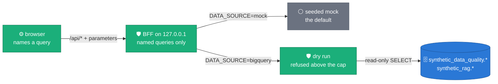

# The Synthetic Platform GUI

[README](README.md) · [CLI](docs/CLI.md) · [Dataflow](docs/DATAFLOW.md) ·
[Composer](docs/COMPOSER.md) · [Results](docs/RESULTS.md) · **GUI**

The evaluator's results can be read with plain SQL, with
`sdfb-eval report` and `compare`, or in the Synthetic Platform: a
self-hosted web app in the source repository's `gui/` folder
([on GitHub](https://github.com/albertols/synthetic-llm-dataflow-bigquery/tree/master/gui);
in a checkout, [`gui/README.md`](https://github.com/albertols/synthetic-llm-dataflow-bigquery/blob/edcfdcd6a621ecf977e9af7b320996f3a9ea7d48/gui/README.md)). The rule that allows it,
and keeps managed dashboard services out, is
[ADR 0042](https://github.com/albertols/synthetic-llm-dataflow-bigquery/blob/edcfdcd6a621ecf977e9af7b320996f3a9ea7d48/docs/adr/0042-self-hosted-platform-gui.md).

**It is not part of the Dataflow Solution Guides copy.** It is TypeScript (a
React single-page app and a small Fastify backend), the pipeline does not
depend on it, and it stays in the source repository.

*Claim: the browser holds no SQL and no credentials; a local backend runs
named, read-only, bytes-capped queries, or serves a seeded mock.*



- **Local-first.** The backend binds `127.0.0.1` by default and refuses
  requests addressed to another host or sent from another site.
- **Read-only.** The browser names a query and passes parameters; the backend
  runs only the queries registered in its registry, binds the values as query
  parameters, and refuses any statement that is not a single `SELECT` or
  `WITH`. It writes nothing to BigQuery or Cloud Storage, and fetched rows live
  only in memory.
- **Bytes-capped.** Every query is dry-run first and refused above
  `MAX_BYTES_BILLED` (10 GiB by default); the job itself also runs with
  `maximumBytesBilled` set. The UI shows each estimate.
- **No GCP needed to try it.** `DATA_SOURCE=mock`, the default, serves a
  seeded, invented dataset (evaluations of a thelook-shaped model) that
  parses against the same types as live rows.

## What it shows for evaluations

The **EVALUATION** tab (`/evaluation`) is built on the evaluator's tables: the
list of evaluations (from the view `evaluation_latest`), one run's scorecards
per family and its drill-downs (columns, pairs, privacy, detection,
relational), and a compare view that names runs measured with a different
catalogue, evaluator or encoding plan instead of judging them. An evaluation
whose last registry event is `RUNNING` and more than 24 hours old reads
**Stale**, not Running. A primary-key duplicate rate on a key the generation
launch adjusted (ADR 0038) is shown with the generator's own verdict from
`validation_runs` next to the evaluator's status. The other tabs explain the
pipeline (INTRO), the RAG embedding space and free-text pools (RAG) and the
generation knobs (CONFIG).

A committed screenshot of the run view, in mock mode:
[`gui/docs/assets/evaluation-run-1440.png`](https://github.com/albertols/synthetic-llm-dataflow-bigquery/blob/edcfdcd6a621ecf977e9af7b320996f3a9ea7d48/gui/docs/assets/evaluation-run-1440.png).

## Run it

Node 22.12 or later and npm 10 or later (`engines` in `gui/package.json`).
In mock mode, with no GCP account:

```bash
cd gui
npm ci
npm run build   # the web app → apps/web/dist
npm start       # the backend: mock data, serves the web app
```

Open <http://127.0.0.1:8787>. Against BigQuery, with your Application Default
Credentials (used by the backend only):

```bash
gcloud auth application-default login
cd gui
npm ci && npm run build
DATA_SOURCE=bigquery GCP_PROJECT=<PROJECT> npm start
```

The datasets default to `synthetic_data_quality` and `synthetic_rag`
(`QUALITY_DATASET`, `RAG_DATASET`), the location to `europe-west3`
(`BQ_LOCATION`). Every variable, the developer loop and the architecture:
[`gui/README.md`](https://github.com/albertols/synthetic-llm-dataflow-bigquery/blob/edcfdcd6a621ecf977e9af7b320996f3a9ea7d48/gui/README.md) and
[`docs/DESIGN.md` §12](../../docs/DESIGN.md#12-platform-gui).
