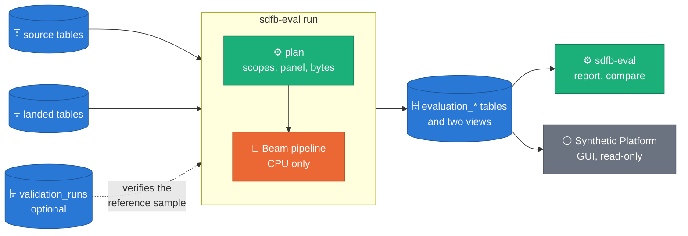
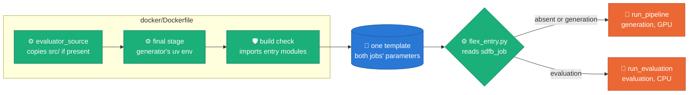

# sdfb-evaluation

Standalone statistical evaluation of synthetic BigQuery tables against their
live source: fidelity, privacy, integrity, and diversity, computed with Apache Beam and
written to BigQuery (`synthetic_data_quality.*`).

It runs after a generation job has landed its tables, as a separate CPU-only
Dataflow job or on your machine, and never gates or fails the generation run.
One file, `src/sdfb_evaluation/catalogue/metrics.yaml`, defines every metric,
from a single field up to the whole relationship model.

> **Status.** Built and tested on a laptop with invented data. It has been
> launched on a deployment from both Composer DAGs, and no launch has completed
> an evaluation yet; what was built after those launches has not run on Google
> Cloud ([ADR 0041](https://github.com/albertols/synthetic-llm-dataflow-bigquery/blob/edcfdcd6a621ecf977e9af7b320996f3a9ea7d48/docs/adr/0041-evaluation-standalone-package.md),
> notes of 2026-10-09 to 2026-10-11).

## What it is

*Claim: the evaluator only reads what generation wrote, and everything
downstream reads the evaluator's tables.*



- **Standalone** ([ADR 0041](https://github.com/albertols/synthetic-llm-dataflow-bigquery/blob/edcfdcd6a621ecf977e9af7b320996f3a9ea7d48/docs/adr/0041-evaluation-standalone-package.md)):
  its own `pyproject.toml` and `uv.lock`, excluded from the root uv workspace,
  and it imports none of `sdfb-core`, `sdfb-beam` or `sdfb-tests`
  (`tests/unit/test_independence.py` checks every import under `src/`). Its
  Python and Beam pins are held equal to the generator's, whose environment it
  runs on in the image.
- **Reads** a target (a generation job, a launch's run id, the table a launch
  targeted with its relationship component, or tables named by hand), plans it
  before reading a row (scope, reference panel, method per column, dry-run
  bytes against a cap), then reads both sides, the source pinned by time
  travel as of the generation job when it can.
- **Writes** a `RUNNING` row, then one terminal row, in the registry, and the
  metric, profile and row-flag rows. A status describes the run, not the data.

## How it is built

*Claim: there is one image and one template, and the parameter `sdfb_job`
alone decides which job a launch runs.*



- **The image, `docker/Dockerfile`.** A throw-away stage (`evaluator_source`)
  copies `packages/` and keeps `packages/sdfb-evaluation/src` only when it
  exists, so a tree without the package still builds (and runs generation
  only). The evaluator is not installed: no second `uv sync`, no second
  virtualenv. Its `src` is last on the launcher's `PYTHONPATH` and a path line
  of the workers' bridge `.pth`, and it runs on what `uv sync` installed for the
  generator; this package's lock serves development and CI. A build step
  imports `sdfb_evaluation.cli.run_evaluation` and
  `sdfb_evaluation.beam.pipeline` in the launcher's and the worker's context,
  and numpy, scipy and scikit-learn in the image's own virtualenv, so a lost
  dependency fails the build, not the first launch.
- **The entry, `docker/flex_entry.py`** (the image's
  `FLEX_TEMPLATE_PYTHON_PY_FILE`), removes `--sdfb_job` and passes every other
  argument unchanged: absent, empty or `generation` calls
  `sdfb_beam.cli.run_pipeline.main`, `evaluation` calls
  `sdfb_evaluation.cli.run_evaluation.main`, and only that module is imported.
  Any other value, or `evaluation` on an image without this package, exits 2.
- **The parameters, `docker/flex_template_metadata.json`**, declare both jobs'
  parameters, every one optional: each job's own parser refuses what it lacks,
  in the launcher. The evaluation-only ones say so in their help text.
- **Workers run the same image:** the image carries its coordinate
  (`SDFB_EVAL_SDK_CONTAINER_IMAGE`), which the evaluator sets as
  `sdk_container_image` when the launch gives none.

## How to use it

**1. On your machine**, from the repository root, with Application Default
Credentials:

```bash
uv sync --project packages/sdfb-evaluation --frozen   # its own .venv
alias sdfb-eval='uv run --project packages/sdfb-evaluation sdfb-eval'
sdfb-eval schemas --project <PROJECT> --apply          # once: 4 tables (kept if present), 2 views
sdfb-eval plan    --project <PROJECT> --region <REGION> --job_id <GENERATION_JOB_ID>
sdfb-eval run     --project <PROJECT> --region <REGION> --job_id <GENERATION_JOB_ID>
sdfb-eval report  --project <PROJECT> --evaluation_id <EVALUATION_ID>
sdfb-eval compare --project <PROJECT> --evaluation_ids <ID_A>,<ID_B>
sdfb-eval catalogue --format md
```

`plan` writes no registry row. `run` prints the `evaluation_id` it mints and
runs on Beam's in-process runner, on a salted sample of each large side by
default. Every flag, the other targets, an offline trial with no GCP:
[`docs/CLI.md`](docs/CLI.md).

**2. On Dataflow**, from the deployment's one template:

```bash
gcloud dataflow flex-template run sdfb-evaluation-$(date +%s) \
  --project <PROJECT> --region <REGION> \
  --template-file-gcs-location gs://<TEMPLATES_BUCKET>/synthetic/sdfb-<VERSION>-template.json \
  --parameters sdfb_job=evaluation,generation_job_id=<GENERATION_JOB_ID>,disk_size_gb=200 \
  --temp-location gs://<BUCKET>/temp \
  --worker-machine-type e2-standard-8 --launcher-machine-type e2-standard-8
```

`disk_size_gb=200` because the workers unpack the same multi-GB image and the
evaluator pins no boot disk. The launch submits the job and returns; the job
writes its own terminal row. Targets, the read path, the launcher's 12
minutes, the reference panel under the temp location:
[`docs/DATAFLOW.md`](docs/DATAFLOW.md).

**3. From Composer** (source repository only): the generation DAG evaluates
its own run (`run_evaluation`, true by default), and the standalone DAG
`composer/evaluation_framework.py` evaluates a run that has already landed:
[`docs/COMPOSER.md`](docs/COMPOSER.md).

**4. In the Dataflow Solution Guides copy**, step 6 evaluates a run:
`scripts/06_run_evaluation.sh RUN_ID`.

## Reading results

| Table or view | One row per |
| :-- | :-- |
| `evaluation_data_history` | event: `RUNNING`, then one terminal row with the run's status, scores and counts |
| `evaluation_metrics` | metric and table, column, pair or edge: value, baseline, noise floor, status, score |
| `evaluation_profiles` | distribution payload per table, column or edge and side |
| `evaluation_row_flags` | flagged synthetic row, keys and keyed hashes only |
| view `evaluation_latest` | evaluation: its last event |
| view `evaluation_latest_per_job` | generation job: the latest `FINAL` row naming it |

`report` explains every failing metric with the catalogue's own text;
`compare` marks a difference that lies inside sampling noise. Baselines, noise
floors, lifts, statuses, your own thresholds:
[`docs/RESULTS.md`](docs/RESULTS.md).

## The GUI

The Synthetic Platform (`gui/`, ADR 0042) is a self-hosted, local-first web
app that reads these tables read-only, or a seeded mock with no GCP access.
It stays in the source repository: [`GUI.md`](GUI.md).

## Reference

- [`docs/CLI.md`](docs/CLI.md): install, every command and flag, targets, sinks, exit codes, an offline trial.
- [`docs/DATAFLOW.md`](docs/DATAFLOW.md): launch parameters, the read path, the launcher's budget, the reference panel; there is deliberately no image or template of this package's own.
- [`docs/COMPOSER.md`](docs/COMPOSER.md): the chained and the standalone DAG.
- [`docs/RESULTS.md`](docs/RESULTS.md): tables and views, the registry, statuses, baselines, noise floors, lifts, thresholds.
- [`GUI.md`](GUI.md): the Synthetic Platform GUI.
- Design: [`docs/DESIGN.md` §11](../../docs/DESIGN.md#11-evaluation-sdfb-evaluation) and the full [evaluation design](https://github.com/albertols/synthetic-llm-dataflow-bigquery/blob/edcfdcd6a621ecf977e9af7b320996f3a9ea7d48/docs/designs/2026-07-07-evaluation-framework-design.md); decision: [ADR 0041](https://github.com/albertols/synthetic-llm-dataflow-bigquery/blob/edcfdcd6a621ecf977e9af7b320996f3a9ea7d48/docs/adr/0041-evaluation-standalone-package.md).
- Operating: [`RUN_PLAYBOOK.md`](https://github.com/albertols/synthetic-llm-dataflow-bigquery/blob/edcfdcd6a621ecf977e9af7b320996f3a9ea7d48/docs/RUN_PLAYBOOK.md) §5a "Evaluate a run"; tables, IAM, temp location: [`DEPLOYMENT_PREREQUISITES.md`](../../docs/DEPLOYMENT_PREREQUISITES.md) "Evaluator".
- For agents: [`.claude/skills/evaluation-framework/SKILL.md`](https://github.com/albertols/synthetic-llm-dataflow-bigquery/blob/edcfdcd6a621ecf977e9af7b320996f3a9ea7d48/.claude/skills/evaluation-framework/SKILL.md).
