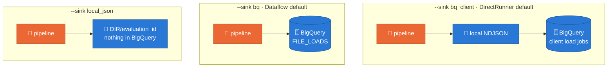

# `sdfb-eval`: the command line

[README](../README.md) · **CLI** · [Dataflow](DATAFLOW.md) ·
[Composer](COMPOSER.md) · [Results](RESULTS.md) · [GUI](../GUI.md)

One command plans, runs, reports on and compares evaluations. The entry point
is `sdfb_evaluation.cli.main:main` (`[project.scripts]` in `pyproject.toml`).
Every flag below is quoted from `sdfb-eval <command> --help`.

## Install

From the repository root. The package has its own environment
(`packages/sdfb-evaluation/.venv`) and lock; `--frozen` installs exactly what
the lock says.

```bash
uv sync --project packages/sdfb-evaluation --frozen
uv run --project packages/sdfb-evaluation sdfb-eval --help
uv run --project packages/sdfb-evaluation pytest packages/sdfb-evaluation/tests -q -m "not gcp"
```

If the root project's environment is active in your shell, `uv` warns that
`VIRTUAL_ENV` does not match and ignores it; `env -u VIRTUAL_ENV uv …`
silences the warning. Never pass `--active` here: it would install this
package's dependencies into the root environment. Commands that reach
BigQuery or Dataflow read Application Default Credentials.

Below, `sdfb-eval` stands for `uv run --project packages/sdfb-evaluation
sdfb-eval`.

## The commands

| Command | What it does |
| :-- | :-- |
| `plan` | plan an evaluation without running it |
| `run` | run one evaluation (Beam arguments may follow) |
| `report` | render a stored evaluation |
| `compare` | compare two stored evaluations (A,B) |
| `catalogue` | print the metric catalogue |
| `schemas` | print or create the evaluation tables and views |

`sdfb-eval --version` prints the evaluator's version.

## A target: exactly one

`plan` and `run` take the same target flags. Name exactly one of these, or
`--relationships_uri` alone; `--project` is always required.

| Target | Flags |
| :-- | :-- |
| a generation Dataflow job | `--job_id J --region R` (alias `--generation_job_id`) |
| a launch by its base run id | `--run_id B`, looked up in `validation_runs` of `--output_dataset` |
| tables named by hand | `--tables A,B --landing_dataset L --reference_dataset D`, parents first |
| what a launch of one table generated | `--seed_table T --landing_dataset L --reference_dataset D`; with `--relationships_uri`, T's enabled component, parents first |
| the same, with the job that ran it | `--seed_table T --job_id J --region R` and the two datasets: the job id is the launch's identity, only the Dataflow job is read (its window, never its log) |
| every enabled table of a model | `--relationships_uri M --landing_dataset L --reference_dataset D` |

- `--relationships_uri` (a file or directory, local or `gs://`) may accompany
  any target; it supplies the model when the launch's own records name none.
- A hand-named target (`--tables`, `--seed_table`, a model alone) carries no
  write disposition: pass `--scope manual` to read each landing table whole,
  otherwise its tables cannot be scoped.
- The reference-based privacy metrics need the generation's reference sample
  rebuilt and verified. For a hand-named target pass `--reference_rows_limit`
  (the generation's value) and `--validation_runs_table` (the generator's
  table), with `--job_id` next to `--seed_table` so the job's window is known.
  Without them those metrics are `not_evaluated`, with the reason on the row.

## `plan`

Builds the plan and stops: tables and roles, scope, row counts, the reference
panel, the method per column, the BigQuery dry-run bytes against
`--max_bytes_billed` and the predicted shuffle against `--max_shuffle_gb`.
It issues the planning queries, never runs the prepare statements and never
writes a registry row. The one thing it may create is the zero-byte, 24-hour
start snapshot of a table whose scope is `as_of_diff`, because that scope is
read through it.

| Flag | Help |
| :-- | :-- |
| `--dry_run` | a plan never writes; the flag only says so |
| `--no_planning_snapshots` | do not create `as_of_diff` start snapshots; those tables are reported UNPLANNED |
| `--format {text,json}` | output |

It also takes every target flag and every flag of the "mode, scope, sampling,
limits, budgets" group below.

## `run`

One evaluation: plan, `RUNNING` row, prepare statements, the pipeline, the
outputs, the terminal row. Every attempt mints its own `evaluation_id`
(`eval-<UTC yyyymmddThhmmssZ>-<8 hex>`), printed first; `--evaluation_id` is
refused.

| Group | Flags, with their defaults |
| :-- | :-- |
| mode and scope | `--runner` (DirectRunner), `--mode {exact,sampled}` (sampled on the DirectRunner, exact on Dataflow), `--scope {auto,table,as_of,appends,as_of_diff,manual}` (auto), `--allow_contaminated` |
| sampling | `--sample_rows` (200000), `--privacy_sample_rows` (50000), `--detection_sample_rows` (50000) |
| limits | `--pair_max_columns` (20), `--row_flags_top_k` (100), `--row_flags_source_keys {hashed}` |
| budgets | `--max_bytes_billed` (1 TiB), `--max_shuffle_gb` (500) |
| output | `--output_dataset` (synthetic_data_quality), `--temp_dataset` (the output dataset), `--sink {bq,bq_client,local_json}`, `--output_local DIR` |
| control | `--thresholds_uri`, `--fail_on {none,warn,fail}` (none), `--trigger {cli,composer,chained,agent}` (cli), `--label_key_uri` |

- **An empty value means "not given"** for every flag of this command line
  (`--mode=`, `--output_dataset ""`), so the default applies: a flex template
  and Composer pass every parameter, the unset ones empty. A boolean flag
  takes an optional value (`--allow_contaminated=false`).
- **Beam's own arguments** follow the evaluator's (`--temp_location`,
  `--num_workers`, `--experiments`, …). A malformed one is a usage error
  before anything starts. The experiment `enable_data_sampling` is refused: it
  would sample pipeline elements, the label key among them, into Dataflow's
  monitoring UI.
- **Runners.** `--runner DirectRunner` means "run it here" and is what the
  registry records; the pipeline runs on Beam's in-process `FnApiRunner`,
  because Beam hands a `DirectRunner` batch pipeline to Prism, which can start
  a step before its side input is complete. `--runner PrismRunner` is refused.
  `--runner DataflowRunner` is in [DATAFLOW.md](DATAFLOW.md).
- **Sampled mode** reads a salted sample of each side larger than
  `--sample_rows`. A row computed from a sampled side carries `method =
  sample` and its `sample_rate`; a metric that needs every row of a side is
  `not_evaluated` with "sampled mode cannot measure …". Run `--mode exact` for
  those.

*Claim: the sink decides where rows go, and the runner decides the default
sink.*



`--output_local DIR` keeps the files under `DIR/<evaluation_id>`
(`local_json` requires it; `bq_client` otherwise uses a temporary directory).
`bq_client` and `local_json` write where the pipeline runs, so on Dataflow
only `--sink bq` is accepted.

**The label key.** Row flags and profile labels are keyed hashes. Without
`--label_key_uri` the key is random and lives for one run; with it (a Secret
Manager version `projects/P/secrets/S/versions/V`, a `gs://` object or an
absolute path) labels are stable across runs. A worker reads the key; the
registry records only `operator` or `ephemeral`.

### Exit codes of `run`

| Code | Meaning |
| :-- | :-- |
| 0 | the evaluation finished and no gate tripped |
| 1 | the `--fail_on` gate tripped, and nothing else |
| 2 | a usage error: nothing was started (no registry row, no DDL); a bad thresholds file and `--runner PrismRunner` are usage errors too |
| 3 | the evaluation failed: its terminal row reads `FAILED`, or the command raised (its `FAILED` row is written first when the outcome is its to record). `--fail_on none` does not mask it |

| Run status | `--fail_on none` | `--fail_on warn` or `fail` |
| :-- | :-- | :-- |
| `SUCCEEDED`, `SUCCEEDED_WITH_WARNINGS` | 0 | 1 if a metric is at FAIL (`fail`), or at WARN or FAIL (`warn`) |
| `PARTIAL` | 0 | 1: the gate cannot vouch for a table that was not evaluated |
| `SKIPPED` | 0 | 0: an empty scope is a planned outcome |
| `FAILED` | 3 | 3 |

The flex-template entry never applies `--fail_on` (it submits the job and
returns). The other commands exit 0 when done and 2 on a usage error; any
other error propagates with its traceback.

## `report`, `compare`, `catalogue`, `schemas`

| Command | Flags |
| :-- | :-- |
| `report` | `--project` (the project of the evaluation tables), `--output_dataset` (synthetic_data_quality), `--local DIR` (read a local evaluation directory instead of BigQuery), `--evaluation_id`, `--format {md,json}` (md), `--out PATH` |
| `compare` | the same store flags, `--evaluation_ids A,B` (exactly two), `--format {md,json}` (md), `--out PATH` |
| `catalogue` | `--format {json,md}` (json), `--out PATH` |
| `schemas` | `--project` (required), `--dataset` (synthetic_data_quality), `--apply` |

`schemas` without `--apply` prints the four `bq mk` commands and the two
`CREATE OR REPLACE VIEW` statements; with it, it creates the tables that are
missing (an existing table is never altered) and replaces the views, in a
dataset that must exist. What `report` and `compare` show:
[RESULTS.md](RESULTS.md).

## Try it offline

`plan` and `run` take a hidden flag, `--fixture_dir DIR`, that evaluates rows
held in JSON files with no call to GCP: `DIR/fixture.json` names the tables
(schema, keys, edges, panel size) and `DIR/<table>.source.json` and
`DIR/<table>.synthetic.json` hold the rows. The format is the docstring of
`src/sdfb_evaluation/cli/fixture.py`. It is its own target.

```bash
sdfb-eval plan --fixture_dir DIR
sdfb-eval run  --fixture_dir DIR --sink local_json --output_local OUT
sdfb-eval report  --local OUT/<EVALUATION_ID>
sdfb-eval compare --local OUT --evaluation_ids <ID_A>,<ID_B>
```

On a two-table fixture of invented rows these four commands ran on a laptop
for this page (2026-10-15) and wrote the four tables' rows as NDJSON under
`OUT/<evaluation_id>/`, one directory per table.
