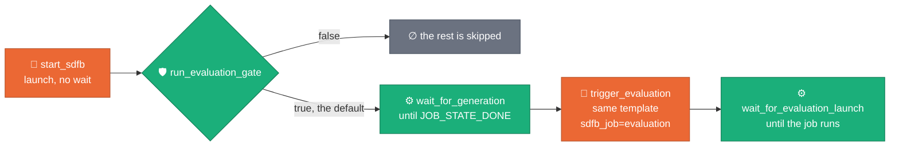
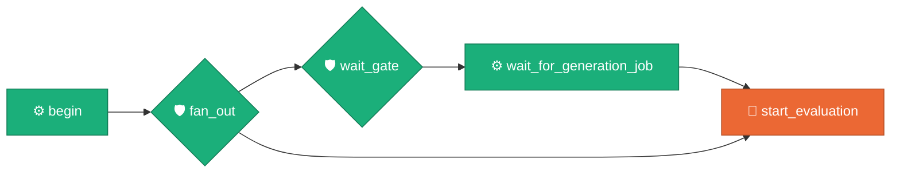

# The evaluator from Composer

[README](../README.md) · [CLI](CLI.md) · [Dataflow](DATAFLOW.md) ·
**Composer** · [Results](RESULTS.md) · [GUI](../GUI.md)

Two Airflow DAGs launch evaluations, both from the deployment's one Flex
Template with `sdfb_job=evaluation`. They live in the source repository only
(`composer/`), not in the Dataflow Solution Guides copy, so this page says
what they do without needing the files. Both have launched evaluations on a
deployment; the notes of 2026-10-09 to 2026-10-14 in
[ADR 0041](https://github.com/albertols/synthetic-llm-dataflow-bigquery/blob/edcfdcd6a621ecf977e9af7b320996f3a9ea7d48/docs/adr/0041-evaluation-standalone-package.md) record
what those launches showed and what is still unverified.

| DAG | File | Use it when |
| :-- | :-- | :-- |
| the generation DAG | `composer/synthetic_beam_bigquery.py` | you want each generation run evaluated as soon as it lands (on by default) |
| `sdfb_evaluation_framework` | `composer/evaluation_framework.py` | a run has already landed and you want it evaluated on its own: again, or because the generation DAG ran with `run_evaluation` false |

## The generation DAG evaluates its own run

*Claim: with `run_evaluation` true, the default, a run launches generation,
waits for it, launches the evaluation and waits only until that launch is
over.*

| Param | Default | Goes to |
| :-- | :-- | :-- |
| `run_evaluation` | true | the gate; false launches generation alone |
| `evaluation_mode` | empty (`exact`, `sampled`) | template `mode`; empty is exact on Dataflow |
| `evaluation_machine_type` | `e2-standard-8` | the evaluation job's workers |
| `evaluation_launcher_machine_type` | `e2-standard-8` | the launcher VM (`environment.launcherMachineType`) |
| `evaluation_max_workers` | 8 | `maxWorkers` |
| `source_dataset` | empty: the dataset of `table_fqn` | template `reference_dataset` |
| `evaluation_output_dataset` | the dataset of the validation-runs table, else `synthetic_data_quality` | template `output_dataset` |

What `trigger_evaluation` passes, besides `sdfb_job=evaluation`:
`generation_job_id` (the launch's identity: the evaluator reads the Dataflow
job for its window, never its log), `seed_table` (the last part of
`table_fqn`), `relationships_uri` (empty when `generate_fk_relationships` is
false), `landing_dataset`, `reference_dataset`, `scope=manual`,
`reference_rows_limit` (10000, the value the generation launch passes),
`validation_runs_table`, `trigger=chained`, `mode`, `output_dataset` and
`disk_size_gb=200`.

- **What is evaluated.** The launched table's enabled component in the
  relationship model, parents first, or that table alone. Each landing table
  is read whole: with `write_disposition` overwrite that is this launch's rows,
  with append it includes earlier launches' (the row count then differs and
  the run reads `PARTIAL`). A landing table named differently from its source
  is not found.
- **What it needs.** It runs under the generation job's service account, in
  its subnetwork, as a CPU job. Of the roles that read a job it needs only
  `roles/dataflow.viewer` (without it: a warning and no window), plus read on
  the `validation_runs` table; the four tables and two views must exist.
- **Who closes the registry row.** `trigger_evaluation` returns as soon as the
  job is queued, before the launcher writes the `RUNNING` row.
  `wait_for_evaluation_launch` waits until the job is running (or already
  done). When the launch dies instead, the job ends failed, the sensor fails
  and, after the task's retries, its failure callback writes the `FAILED`
  row. A job that dies after
  the sensor saw it running leaves its `RUNNING` row open: close it by hand
  ([`RUN_PLAYBOOK.md`](https://github.com/albertols/synthetic-llm-dataflow-bigquery/blob/edcfdcd6a621ecf977e9af7b320996f3a9ea7d48/docs/RUN_PLAYBOOK.md#a-running-row-that-never-closes)).
- **Run slot.** The DAG has `max_active_runs=1`, and a run holds the slot
  until the generation job ends and the evaluation's launch is over, so later
  triggers queue behind it.

## The standalone DAG

`sdfb_evaluation_framework` (`schedule_interval=None`, manual) evaluates the
way the chain does, by the seed path: the launched table (`seed_table`) and
its enabled group of tables, each landing table read whole, compared with
the same-named table in the source dataset. Its launch waits for the job
(`wait_until_finished=True`), so a job that fails after launch fails the task
and the failure callback closes the `RUNNING` row; the cost is a worker slot
held while the evaluation runs.

| Trigger shape | Params | Reads |
| :-- | :-- | :-- |
| 1. a landed run, no logs | `seed_table` and the datasets as the import filled them, plus `generation_job_id` when known | the Dataflow job (window, needs `roles/dataflow.viewer`) and this launch's `validation_runs` rows |
| 2. job id unknown | `seed_table` alone | neither: the reference sample is not verified |
| 3. the full lookup | `generation_job_id` alone, `seed_table` emptied | the job's log and BigQuery job metadata (`roles/logging.viewer`, `roles/dataflow.viewer`, `roles/bigquery.resourceViewer`) |
| 4. older shapes | `run_id`, or `tables` with the datasets | `validation_runs`, or the tables |

| Param | Default | Goes to |
| :-- | :-- | :-- |
| `generation_job_id` | empty | template `generation_job_id`; the sensor's job |
| `generation_job_ids` | empty list | `fan_out`: one run of this DAG per id, each the full lookup of its own job, one after another |
| `seed_table` | the table name of the import's default table | template `seed_table`, unless `run_id` or `tables` is given |
| `run_id`, `tables`, `relationships_uri` | empty | the template parameter of the same name |
| `landing_dataset`, `source_dataset` | from the import's landing and default tables | template `landing_dataset`, `reference_dataset` |
| `reference_dataset` | empty | when set, it replaces `source_dataset` |
| `scope` | empty: `manual` with a seed or `tables`, else the evaluator's `auto` | template `scope` |
| `reference_rows_limit` | 10000 | template `reference_rows_limit` |
| `validation_runs_table` | the import's validation-runs table | template `validation_runs_table` |
| `mode`, `allow_contaminated`, `output_dataset` | empty, false, `synthetic_data_quality` | the template parameters of the same name |
| `trigger` | `composer` | template `trigger` |
| `wait_for_generation` | false | `wait_gate`: wait for `JOB_STATE_DONE` first |
| `machine_type`, `launcher_machine_type`, `max_workers` | `e2-standard-8`, `e2-standard-8`, 8 (at least 4) | the launch environment, not the template |

It is a template: the import workflow substitutes its markers, the same ones
it substitutes for the generation DAG (`{{PROJECT_VERSION}}`, `{{ENV}}`, the
two bucket markers and three table markers), and it reads the Airflow
Variables `PROJECT_ID`, `REGION`, `SA_DATAFLOW`, `DATAFLOW_SUBNET` and,
optionally, `DATAFLOW_NETWORK_TAGS`. Its launch passes no template
parameter named `runner`, `project`, `region`, `sdk_container_image`,
`experiments` or `fail_on`.

**The failure callback.** A failed `start_evaluation` reads the job's state
first, through the job id the launch pushed to XCom. Only a job that ended
`FAILED`, `CANCELLED`, `UPDATED` or `DRAINED` gets a `FAILED` row: one
`INSERT … SELECT` into `evaluation_data_history` that copies this DAG run's
`RUNNING` row and skips an evaluation that already has a `FINAL` one. A job
still running, done, or unreadable, and a launch with no job id in XCom, get
one warning and no row. A launch whose only target is `tables` cannot be
matched, so it is never closed this way. The generation DAG's
`wait_for_evaluation_launch` carries a copy of this callback.

## The launcher

Both evaluation launches name their launcher VM (`launcher_machine_type`
here, `evaluation_launcher_machine_type` in the generation DAG), because a
Flex Template launch has 12 minutes in all, the image pull included, and the
public REST description of a launch has no field for the limit itself. Where
those minutes go: [DATAFLOW.md](DATAFLOW.md#the-launchers-12-minutes).
