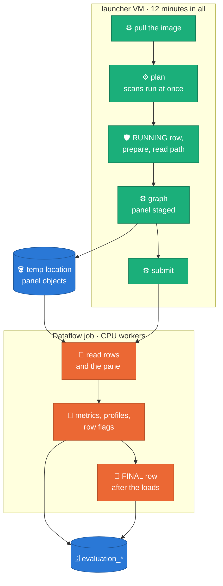
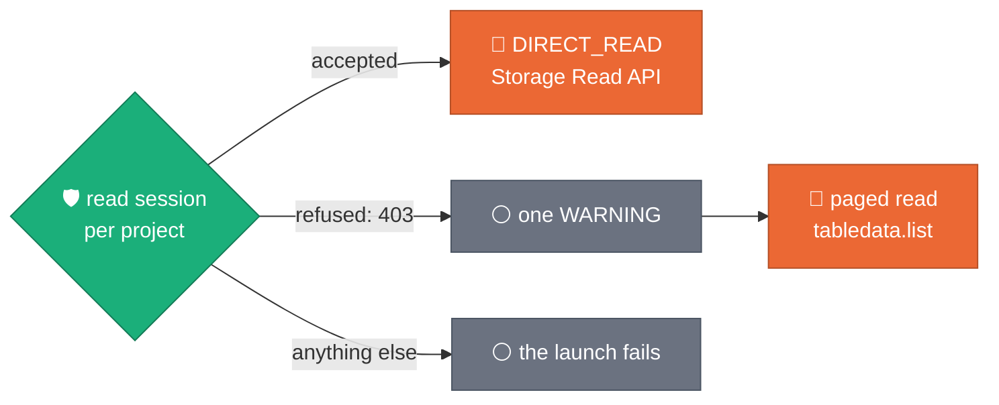

# The evaluator on Dataflow

[README](../README.md) · [CLI](CLI.md) · **Dataflow** ·
[Composer](COMPOSER.md) · [Results](RESULTS.md) · [GUI](../GUI.md)

On Dataflow the evaluator is a CPU-only batch job launched from the
repository's one image and one Flex Template, the same ones generation uses.
There is deliberately no image or template of this package's own
([ADR 0041, amendment of 2026-10-06](https://github.com/albertols/synthetic-llm-dataflow-bigquery/blob/edcfdcd6a621ecf977e9af7b320996f3a9ea7d48/docs/adr/0041-evaluation-standalone-package.md#amendment-2026-10-06-one-image-one-template)).
How the image carries it and how the entry dispatches:
[README, "How it is built"](../README.md#how-it-is-built).

## What runs where

*Claim: everything before the Dataflow job exists runs on the launcher VM,
inside the Flex Template launch's 12 minutes; the job then writes its own
rows and its own terminal row.*



The template entry (`src/sdfb_evaluation/cli/run_evaluation.py`) takes the
same flags as `sdfb-eval run`. It writes the `RUNNING` row, submits the job and
returns without waiting, and it never applies `--fail_on`. If anything raises
before the submission it writes the `FAILED` row itself; after it, the job
writes the `FINAL` row, and a job that dies leaves its `RUNNING` row for an
orchestrator to close ([RESULTS.md](RESULTS.md#the-registry)).

## Launch it from the template

```bash
gcloud dataflow flex-template run sdfb-evaluation-$(date +%s) \
  --project <PROJECT> --region <REGION> \
  --template-file-gcs-location gs://<TEMPLATES_BUCKET>/synthetic/sdfb-<VERSION>-template.json \
  --parameters sdfb_job=evaluation,generation_job_id=<GENERATION_JOB_ID>,disk_size_gb=200 \
  --temp-location gs://<BUCKET>/temp \
  --worker-machine-type e2-standard-8 --launcher-machine-type e2-standard-8
```

The template path is the one the deployment built: in this repository's
Composer layout `gs://<templates>/synthetic/sdfb-<version>-template.json`, in
the Dataflow Solution Guides copy `${TEMPLATE_PATH}`. The launcher supplies the
runner, project and region; they are not template parameters. An unset
parameter reaches the evaluator as an empty string, which it reads as "not
given".

| Parameter | Why it matters |
| :-- | :-- |
| `sdfb_job=evaluation` | selects the evaluator's entry; without it the launch is a generation launch and fails for lack of the generator's parameters |
| a target | exactly one, as on the command line ([CLI.md](CLI.md#a-target-exactly-one)); `generation_job_id` is the template's name for `--job_id` (the launcher does not pass a parameter named `job_id`) |
| `disk_size_gb=200` | Beam's own worker boot disk. The workers unpack the same multi-GB image as generation's; the generator pins 200 GB in code, the evaluator pins nothing. Never pass it empty: Beam refuses an empty number |
| `scope=manual` | with `seed_table`, `tables` or a model alone: read each landing table whole |
| `reference_rows_limit`, `validation_runs_table` | with a hand-named target: rebuild and verify the generation's reference sample, so the reference-based privacy metrics are evaluated |
| `mode` | empty means exact on Dataflow; `sampled` for tables too large to read in full |
| `output_dataset`, `temp_dataset` | where the four tables, and the expiring scope, pin and sample tables, go |

`generation_job_id` alone is the full lookup: the evaluator reads the
generation job's log and BigQuery job metadata to name its tables, which
needs `roles/logging.viewer`, `roles/dataflow.viewer` and
`roles/bigquery.resourceViewer`. The seed path reads no log: the launched
table names the tables, and the job id, when given, is only the launch's
identity:

```bash
--parameters sdfb_job=evaluation,seed_table=<TABLE>,landing_dataset=<PROJECT>.<LANDING_DATASET>,reference_dataset=<PROJECT>.<SOURCE_DATASET>,scope=manual,generation_job_id=<GENERATION_JOB_ID>,reference_rows_limit=10000,validation_runs_table=<PROJECT>.synthetic_data_quality.validation_runs,disk_size_gb=200
```

Every parameter, with its help text, is in
`docker/flex_template_metadata.json`; the evaluation-only ones start
"Evaluation only".

## Or from the command line

```bash
sdfb-eval run --runner DataflowRunner \
  --project <PROJECT> --region <REGION> --job_id <GENERATION_JOB_ID> \
  --temp_location gs://<BUCKET>/temp \
  --sdk_container_image <THE_DEPLOYMENT_IMAGE> --disk_size_gb 200
```

On the `DataflowRunner` the defaults are `--mode exact --sink bq`: the pipeline
writes BigQuery itself, the `FINAL` row after every other write is committed.
The command waits for the job, so `--fail_on` still decides its exit code.
The evaluator always adds the experiment `upload_graph`, sizes the workers'
side-input cache from the plan, names the job `sdfb-` and the
`evaluation_id` in lower case unless `--job_name` is given, and keeps your
other Beam arguments. Outside the image
there is no baked worker image, so pass `--sdk_container_image`; without it the
workers boot the stock Beam image and cannot import `sdfb_evaluation`.

## The read path

*Claim: a project that refuses a read session costs speed, not the
evaluation.*



The job reads source and landed rows through the
[BigQuery Storage Read API](https://docs.cloud.google.com/bigquery/docs/reference/storage)
(`DIRECT_READ`), which needs `bigquery.readsessions.create`
(`roles/bigquery.readSessionUser`) on the project of each table it reads.
After the prepare statements and before the graph, the launch asks for one
read session per project of the planned read tables. The tables of a project
that refuses (a 403) are paged through the BigQuery client's
[`tabledata.list`](https://docs.cloud.google.com/bigquery/docs/paging-results),
which needs only `bigquery.tables.get` and `bigquery.tables.getData` (both in
`roles/bigquery.dataViewer`). Any other answer fails the launch.

| | `DIRECT_READ` | Paged read |
| :-- | :-- | :-- |
| A table gets it when | its project accepted | its project refused |
| Speed | the API's streams | bounded by a quota of the project that contains the table, shared with every other reader of that project ([BigQuery quotas](https://docs.cloud.google.com/bigquery/quotas), `tabledata.list`) |
| A table written to while it is read | read as the session saw it | the job fails (`TableChangedError`): evaluate once nothing writes to it |
| Too large for it | — | `--mode sampled` reads a sample of each side |

The launch names what it pages in one `WARNING` that starts `the BigQuery
Storage Read API refused a read session on project`, and the registry row
keeps it in `warnings`. Granting the role later moves the same image to the
fast read; no parameter chooses the path. The paged read has not read from
BigQuery yet. Design:
[§5.2](https://github.com/albertols/synthetic-llm-dataflow-bigquery/blob/edcfdcd6a621ecf977e9af7b320996f3a9ea7d48/docs/designs/2026-07-07-evaluation-framework-design.md#52-the-graph).

## The launcher's 12 minutes

A Flex Template launch has 12 minutes for everything up to the job's
submission, the image pull included ("By default, the Flex Template launch
process has a timeout of 12 mins",
[Google, troubleshoot Flex Templates](https://docs.cloud.google.com/dataflow/docs/guides/troubleshoot-templates)).
A larger launcher VM (`--launcher-machine-type`, REST
`environment.launcherMachineType`) pulls faster. So each step prints its
seconds, in this order:

| Line | What it times |
| :-- | :-- |
| `evaluation <id>: target check`, `launch lookup`, `relationship models` | naming the tables and resolving the launch |
| `planning <id> <table>: locate`, `source pin`, `planning tables` | per table, one after another: metadata only |
| `planning <id> (all tables): dry runs` | the byte budget, before anything is billed |
| `planning <id> <table>: planning statistics`, `scope verification`, `reference panel` | one table's scans; up to eight tables are scanned at once, so these lines overlap |
| `planning <id> (all tables): scans` | the wall time of that whole phase |
| `planning <id> <table>: sampling`, then `(all tables): census` | table after table again |
| `evaluation <id>: RUNNING row`, `prepare statements`, `read path` | the registry row, the DDL, the read-session probe |
| `evaluation <id>: free text pools`, `pipeline options`, `graph`, `pipeline run`, then `submission` (their sum) | building the pipeline and handing it to the runner |
| `evaluation <id>: panel staging: <n> objects, <size>, <s>s (<w>s in the writes)` | the panel objects written while the graph was built (part of `graph`) |
| `evaluation <id>: pipeline run: Starting GCS upload to …` | Beam's own upload lines, relayed |

What a cold, full-size launch must show, and what to conclude when it does
not, is in [`RUN_PLAYBOOK.md`](https://github.com/albertols/synthetic-llm-dataflow-bigquery/blob/edcfdcd6a621ecf977e9af7b320996f3a9ea7d48/docs/RUN_PLAYBOOK.md) §5a. The launch
that did not fit, with its measured figure:
[ADR 0041, note of 2026-10-11](https://github.com/albertols/synthetic-llm-dataflow-bigquery/blob/edcfdcd6a621ecf977e9af7b320996f3a9ea7d48/docs/adr/0041-evaluation-standalone-package.md).

## The reference panel lives under the temp location

The privacy metrics compare the synthetic rows with the generation's
reference sample R and an equal-size holdout H, rebuilt from the source. On
Dataflow the launch writes that panel (per table its R rows, H rows, panel
hashes and privacy inputs, and one object for the census) as objects under
`<temp_location>/sdfb-evaluation/<evaluation_id>/panel/`, and the job graph
carries only each object's name, sha256 and element count. The temp location
is the one Beam settles on: `--temp_location`, or the staging location when
none is given. A worker checks the digest before it unpickles an object.

So source rows, in clear, sit under the temp location: restrict who can read
it, and give it a lifecycle rule longer than a job, because the objects are
not deleted when the job ends. A launch that cannot write there fails before
it submits, with a `FAILED` registry row. A local run keeps the panel in the
pipeline. Permissions, the lifecycle rule and the rest of the evaluator's
IAM: [`DEPLOYMENT_PREREQUISITES.md`](../../../docs/DEPLOYMENT_PREREQUISITES.md),
"Evaluator".
