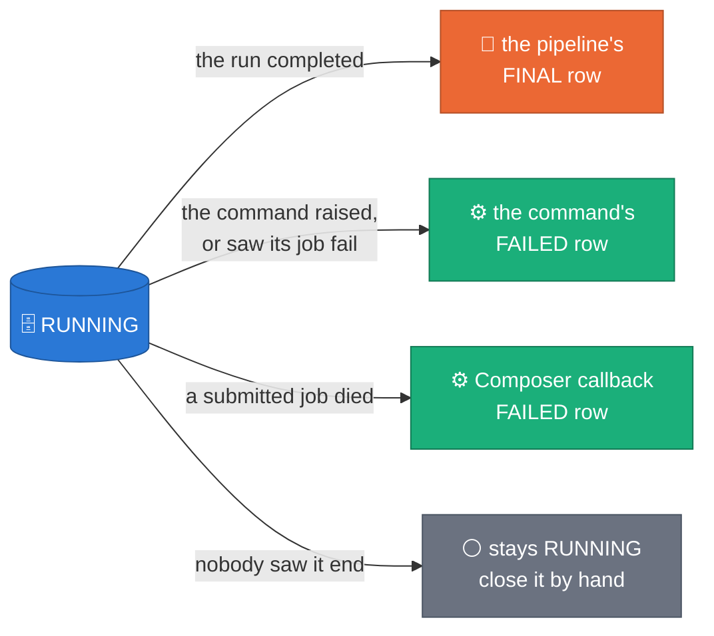

# Reading an evaluation

[README](../README.md) · [CLI](CLI.md) · [Dataflow](DATAFLOW.md) ·
[Composer](COMPOSER.md) · **Results** · [GUI](../GUI.md)

Everything an evaluation writes lands in four tables and is read through two
views, in `synthetic_data_quality` unless `--output_dataset` says otherwise.
The full treatment, with every figure and primary source, is the
[evaluation design](https://github.com/albertols/synthetic-llm-dataflow-bigquery/blob/edcfdcd6a621ecf977e9af7b320996f3a9ea7d48/docs/designs/2026-07-07-evaluation-framework-design.md)
§4, §6 and §7; the agents' skill card is
[`.claude/skills/evaluation-framework/SKILL.md`](https://github.com/albertols/synthetic-llm-dataflow-bigquery/blob/edcfdcd6a621ecf977e9af7b320996f3a9ea7d48/.claude/skills/evaluation-framework/SKILL.md).

## Tables and views

`sdfb-eval schemas --project P` prints how they are created (the schemas are
`src/sdfb_evaluation/schemas/*.schema.json` and `views.sql`); `--apply`
creates them.

| Table or view | One row per | Partition, cluster |
| :-- | :-- | :-- |
| `evaluation_data_history` | event of an evaluation (`RUNNING`, `FINAL`): status, versions, the generation context, family scores, metric counts, bytes, warnings | day on `recorded_at`; `relationship_model, engine, evaluation_id` |
| `evaluation_metrics` | metric × table × column, pair or edge: value, per-side values, baseline, noise floor or interval, n, method, thresholds, status, score | month on `evaluated_at`; `table_name, metric_id, evaluation_id` |
| `evaluation_profiles` | profile × table × column or edge × side: histograms, quantiles, top-k, shape and temporal mixes, NULL patterns, correlation and contingency tables, ROC curves | month on `evaluated_at`; `table_name, profile_kind, evaluation_id` |
| `evaluation_row_flags` | flagged row, at most `--row_flags_top_k` per check and table (`exact_copy`, `near_copy`, `nearest_record`, `detectable`): keys and keyed hashes only, never a raw source key | month on `evaluated_at`, partitions expire; `table_name, check, evaluation_id` |
| view `evaluation_latest` | evaluation: its last event, `RUNNING` or `FINAL` | — |
| view `evaluation_latest_per_job` | generation job: the latest `FINAL` row of an evaluation that names one (evaluations with no generation job stay in `evaluation_latest`) | — |

## The registry

`evaluation_data_history` is append-only. An evaluation leaves a `RUNNING`
row and exactly one terminal row (`event = FINAL`), written by whoever owns
the outcome, and by nobody while that is not known.

*Claim: on every path one writer closes the row, or nobody yet; a `RUNNING`
row is the last event recorded, not proof that a job runs.*



| Terminal status | When |
| :-- | :-- |
| `SUCCEEDED` | every launch table was evaluated, no warning |
| `SUCCEEDED_WITH_WARNINGS` | the same, with warnings (an allowed contaminated scope, an unpinned source, a fallback taken) |
| `PARTIAL` | a launch table, or a whole metric block such as a table's privacy block, was not evaluated while others were |
| `SKIPPED` | no launch table can be evaluated by plan, an empty scope for example: a planned outcome |
| `FAILED` | the command caught an error, or the pipeline ran and could evaluate none of its tables |

A status describes the run, not the data: a run whose metrics fail still
`SUCCEEDED`. A `RUNNING` row older than a day most likely belongs to a launch
that died unseen (the tables an evaluation prepares expire after 24 hours);
the GUI shows it as **Stale**.
[`RUN_PLAYBOOK.md`](https://github.com/albertols/synthetic-llm-dataflow-bigquery/blob/edcfdcd6a621ecf977e9af7b320996f3a9ea7d48/docs/RUN_PLAYBOOK.md#a-running-row-that-never-closes),
"A RUNNING row that never closes", lists the open evaluations and has the
statement that closes one by hand.

## How to read a metric row

A row of `evaluation_metrics` carries everything needed to judge it without
another table:

| Column | Read it as |
| :-- | :-- |
| `value` | the metric, synthetic against source |
| `source_value`, `synthetic_value` | the per-side statistic, where the metric has one |
| `baseline_value` | `metric(R, source)`: what a perfect copier of the generation's reference sample R would score. Read the value against it, not against zero |
| `noise_floor`, or `ci_low` and `ci_high` | how large a difference sampling alone produces at these row counts (`noise_floor_method` names the estimator) |
| `threshold_warn`, `threshold_fail` | the thresholds this row was graded against: the catalogue's, or your own |
| `status` | `pass`, `warn`, `fail`, `info` (reported, never graded) or `not_evaluated` (the reason is in `detail`) |
| `score` | 0 to 1, higher is better, from the catalogue's score function |
| `method`, `sample_rate` | how it was computed: `exact`, `binned`, `sketch`, `sample` or `value_sampled` |


*Concept figure, a seeded simulation, not a measurement of a run (owned by
the evaluation design, §4.2; generated by `scripts/doc/make_eval_figures.py`
in the source repository).* A threshold crossing that sampling noise
explains is a pass, and the row says it was downgraded
(`detail.noise_downgraded_from`). Lifts and the holdout share gate on the
cautious bound of their interval. No p-value is reported. The rule, step by
step: design §7.1; the code: `scoring.status_for` and `stats/noise.py`.

**Lifts separate copying from chance.** The generator read only its
reference sample R; the evaluator rebuilds an equal-size holdout H from the
source that the generator never saw. A lift is the rate at which the
synthetic side reproduces records only R holds over the same rate for
records only H holds: chance hits both alike, so only copying lifts it above
1 (`row.memorization_lift`, `row.near_match_lift`, `row.exposure_lift` for
the rows placed in prompts, and per column `field.value_memorization_lift`,
`field.pool_memorization_lift`). The absolute rates `row.near_match_rate` and
`row.exact_match_rate_nonkey` are graded against fixed thresholds, and on a
narrow table (few non-key columns, or only low-cardinality ones) fresh rows
match a source row by coincidence and fail them. That failure is the safe
direction and is kept: read it next to its lift before calling it
memorization.

The lifts and the nearest-neighbour metrics need the reference sample
verified against the digest the generation recorded in `validation_runs`;
without it they are `not_evaluated` with the reason
([CLI.md](CLI.md#a-target-exactly-one)).

## Your own thresholds

The catalogue owns the default warn and fail thresholds
(`sdfb-eval catalogue --format md` lists them). `--thresholds_uri`, a local
path or a `gs://` object, overrides them for the metrics a YAML file names,
for the whole run:

```yaml
thresholds:
  column.ks: {warn: 0.05, fail: 0.10}
  row.coverage: {warn: 0.90, fail: 0.80}
```

The file is checked before anything starts (a bad file is exit 2). Each entry
names a metric the catalogue grades (one it only reports cannot be given a
gate) and gives both `warn` and `fail`, each a finite number of 0 or more, in
the order of the metric's direction: `warn <= fail` for a lower-is-better or
target metric, `warn >= fail` and not both 0 for a higher-is-better one. The
stored `status`, `score`, `threshold_warn` and `threshold_fail` are the
override's, so the roll-ups, the registry's counts and the `--fail_on` gate
follow from them; nothing is graded twice. The registry records
`thresholds_uri` and `thresholds_digest` in `evaluation_params`; `report`
names them and `compare` says when two runs were graded differently. The
generator's `config/thresholds.yml` is a different file in a different
format: never pass one job's file to the other.

## Report and compare

`sdfb-eval report` renders one evaluation as markdown (or `--format json`):
the run's header and scores, its tables, and every failing metric explained
with the catalogue's own text (what it measures, what a bad value means, its
pitfalls). `sdfb-eval compare --evaluation_ids A,B` puts two evaluations side
by side: it says what limits the comparison (a different catalogue, evaluator
version, mode or thresholds; different generation jobs; a re-run of the same
`evaluation_key`), marks a metric delta `≈` when it lies inside the two rows'
own sampling noise, and gives the population stability index between the two
runs' histograms only where both carry the same `edges_digest` (the same bin
edges); otherwise it says `not comparable`.
